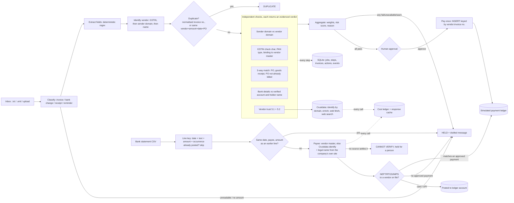

# Payables Desk: Vendor Trust + Pay-Once

ContextCon 05, BITS Pilani · Team Humble Fumblers · Tracks **5. Trust and compliance** + **6. Buying and paying**

An invoice arrives. The agent proves the vendor is real and run by its stated director, screens the director against the news and clears namesakes, matches the invoice to its PO and goods receipt, and catches duplicates, bank-detail changes and look-alike senders. It then **pays once, or holds with a cited reason**. A person approves every payment. Every step is logged and can be replayed.

## The job, and who pays for it today

| | |
|---|---|
| **Job** | Accounts payable for an Indian 3PL: take invoices from the inbox, verify the vendor, match to PO and goods receipt, pay each invoice exactly once, stop fraud before money moves. |
| **Who does it today** | The client's AP team plus outsourced accounting firms (paid per invoice or per month), and KYB/verification vendors (paid per business checked). |
| **Input** | Invoice or email text (`.txt` / `.eml`) in the inbox, the client's vendor master, purchase orders and goods receipts (`data/fixtures/`). |
| **Finished result** | Each document ends as `PAID` (simulated ledger entry with idempotency key), `HELD` (cited reason + drafted verification message), `DUPLICATE` (linked to the original) or `REJECTED` (not payable). |
| **Pass mark** | No invoice paid twice; no payment to an unverified account or unverifiable vendor; every fact cites its source and date; "cannot verify" instead of guessing; a kill at any point resumes without repeating an action. |

## Run it from a fresh clone

Python 3.10+ and the standard library only. No packages to install.

```bash
cp .env.example .env            # then set CRUSTDATA_API_KEY=...
python3 -m vendorcheck.cli inbox        # process every document in data/fixtures/inbox
python3 -m vendorcheck.cli status       # one line per document
python3 -m vendorcheck.cli approve "V001:2026-451" --by "AP lead"   # irreversible step: pay
python3 -m vendorcheck.cli post-bank-lines data/fixtures/bank_lines_oct2026.csv            # bank-statement lines
python3 -m vendorcheck.cli serve --port 8080                       # landing page + app at http://127.0.0.1:8080
```

A vendor check on its own (5.1 + 5.2):

```bash
python3 -m vendorcheck.cli vendor --name "TCI Express" --website tciexpress.in --director "Anil Kumar"
```

**Web app.** `serve` starts the landing page at `/` and the app at `/app`: dashboard, inbox (with bill scanning), approvals, vendors, vendor check, bank lines, ledger, activity and settings. There is no sign-in; the approver name recorded on each payment is set in Settings.

HTTP API (for another system to call): `POST /cases`, `GET /cases/<id>`, `GET /api/invoices`, `GET /api/invoices/<key>`, `POST /api/upload`, `POST /api/approve`, `POST /api/recheck`, `GET /api/payments`.

## Results on the test set (live data, 22 Nov 2026)

| # | Document | Expected | Result |
|---|---|---|---|
| 1 | Shadowfax invoice, clean | Pay after approval | `AWAITING_APPROVAL` → approved → `PAID` once |
| 2 | Shreeji Cargo Movers (fictitious front company) | Hold | `HELD`: no company record carries the domain; cannot verify |
| 3 | TCI Express invoice; director "Anil Kumar" (very common name) | Namesakes cleared | Results about other people named Anil Kumar are cleared ("does not name TCI Express"). The verdict depends on live news: one run returned a report of a police raid at a TCI Express courier warehouse, where the company was the carrier. The service then **holds** the invoice with the exact passage cited and asks a person to judge the company's role, instead of guessing either way. |
| 4 | Shadowfax invoice re-sent as `INV-2026-451` (was `INV/2026/0451`) | Duplicate | `DUPLICATE` of `V001:2026-451` |
| 5 | "We have changed our bank" email | Hold, verify out of band | `HELD` + drafted call-back message to the contact on file (never to the sender) |
| 6 | TCI invoice asking for payment to a new account | Hold | `HELD`: account differs from verified account; PO already invoiced |
| 7 | Invoice from `shadowfaxx.in` (look-alike domain) | Hold | `HELD`: look-alike sender, edit distance 1 |
| 8 | Kill after approval, before payment | Pay once | Restart → `resume` pays once; second resume and re-approve do nothing |

**Bank-statement lines** (the format of the problem statement's own example), `python3 -m vendorcheck.cli post-bank-lines data/fixtures/bank_lines_oct2026.csv`:

| Line | Result |
|---|---|
| 3 Oct, `RAZ*SWIGGY BLR`, ₹1,240 | Payee **Swiggy** (only one of 3 same-name Crustdata records owns swiggy.com and is an established company). Then the legal name is read from the company's own site: swiggy.com's footer states "© 2026 Swiggy Limited", so the payee becomes **Swiggy Limited**, cited to that page and passage. If the site states no legal name, or more than one, the trading name is kept and the reason says "legal name not confirmed". Account: staff meals |
| 7 Oct, `AWS EMEA`, ₹18,500 | Payee **Amazon Web Services EMEA SARL** (vendor master alias). Account: cloud hosting |
| 7 Oct, `AWS EMEA`, ₹18,500 | **Held**: same descriptor, amount and date as the line above; possible duplicate charge |
| 9 Oct, `PAYTM*SHARMA TRD`, ₹4,000 | **Cannot verify**: "SHARMA" matches 4 companies equally; no source identifies the payee. Held for a person |
| 12 Oct, `NEFT/SHADOWFAX TECHNOLOGIES`, ₹2,36,000 | Shadowfax Technologies Limited. Account: freight, last mile. A bank transfer to a vendor on file must match a payment this desk made. After invoice 1 is approved and paid, the line is **reconciled** to that payment (ref, invoice, approver). If no approved payment matches, it is **held**: money left the account with no approved invoice behind it |
| 14 Oct, `UPI/DELHIVERY`, ₹5,600 | Delhivery (Crustdata). Account: freight, express parcel |

Each bank line is posted once. A line's key is its date, description, amount and how many identical lines precede it in the statement. Re-running the file, uploading it under another name, or importing an overlapping statement therefore posts nothing new. Each payment can be claimed by only one bank line. Each line has its own cost limit, so one hard merchant cannot use up the budget for the whole statement. Hitting the limit gives `CANNOT_VERIFY`, never a crash or a guess.

**Offline tests** (no API key, no credits; Crustdata is replaced by canned responses): `python3 -m unittest tests.test_bank -v`. The 9 tests cover:
- the example statement, end to end
- the legal-name citation, and its rules on real and tricky footers
- re-running the file, and re-uploading it under another name
- reconciling a transfer to exactly one payment
- a source outage (the line becomes cannot-verify, not an answer)
- the cost limit
- the cost report

### Scanning a paper bill

In the app, **Inbox → Scan a bill** opens the camera: hold the bill in frame and press Capture, or use **Upload / take photo** (on a phone this opens the camera). From the command line: `python3 -m vendorcheck.cli scan path/to/bill.jpg`.

- **Read on this machine, for ₹0.** Apple Vision on a Mac (compiled once from `vendorcheck/vision_ocr.swift`), Tesseract elsewhere. The photo and the bank details on it never leave the laptop. We ruled out free cloud tiers whose terms let the provider read or train on uploads.
- **Same checks as an emailed invoice.** The rows read from the photo become an inbox document, so duplicates, three-way match, bank and GSTIN checks, the vendor check and pay-once all apply. The only change: a paper bill has no sender, so the sender-domain check reads "not applicable".
- **Every field cites the photo.** The case view shows the photo with the line each field came from outlined, its row and its confidence.
- **Never guessed.** A bill whose invoice number, amount, or GSTIN and vendor name cannot be read is held as "cannot read". A field read below `min_read_confidence` (Settings, default 0.5) holds the bill for a person to compare. A GSTIN that fails its check character is reported as "misread or not real", not as fake. A rupee sign misread as another currency sign is corrected only when it sits directly before a number.
- **Read once.** Files are keyed by the photo's hash: the same photo again is answered from its stored reading, and a second photo of the same bill ends as `DUPLICATE`.
- **Read as an Indian GST invoice** (`vendorcheck/bill.py`):
  - **Parties:** seller, buyer (bill to) and consignee (ship to), each with its own GSTIN and state.
  - **Invoice details:** number, invoice and due dates, place of supply, PO, IRN, Ack no and date, and e-way bill.
  - **Items:** read column by column, including two-line rows and two-row headers.
  - **Tax and total:** taxable value, CGST, SGST, IGST and cess with their rates, round-off, the total, and the total in words.
  - **Bank:** account holder, account number, IFSC, bank, branch and UPI ID.
- **Checked against the bill itself.** Printed values are tested against each other:
  - GSTIN check character, and the IFSC format.
  - Taxable value plus tax equals the total, and the total in words equals the total in figures.
  - CGST equals SGST, and each tax rate matches the taxable value.
  - Intra-state bills charge CGST and SGST; inter-state bills charge IGST.
  - The bank account holder is the seller.

  The total is chosen by this evidence, never by position, so a "Previous balance" or "Sub total" is never taken for it. An invalid GSTIN or IFSC is shown as printed, with the reason it fails.
- **Jev as a second opinion.** Where the code finds more than one candidate (which GSTIN is the seller's, which name is the seller, which amount is the total, which number is the invoice number, which date is the invoice date), Jev picks one. It never sees GSTIN, account or phone numbers.
  - **Agreement** marks the field confirmed.
  - **Disagreement** holds the bill for a person, unless the words, the arithmetic or the check character already settle it.
  - **If Jev is unavailable,** the rules stand.
- **Benchmarked** on real photos of TallyPrime and Vyapar invoices and on public sample invoices (IndiaFilings, GSTZen), whose reader output is kept in `data/fixtures/ocr/` for `python3 -m unittest tests.test_bill -v`.

Tests: `python3 -m unittest tests.test_scan -v` (13 run anywhere with a fake reader; 2 use the real reader on the test photos in `data/fixtures/bills/`, made by `tests/make_bills.swift`).

## How it works

The flow, as Mermaid:

**Public diagram link** (opens for anyone, no sign-in; for the submission form): [architecture diagram](https://mermaid.ink/img/pako:eNptVVFv4jgQ_isjXm5XpKDd072gUysILKCyNEdYtKtcH0wyBF8dO7IdWoT6329sJ7SV9gUHe-bzzDffjC-9XBXYG0HvINRzfmTawmrzrwRYrrOl3KuXEQzsi4UhDLAStDS1UKx4hJubW4hXWSyYMfxwHgGXJ8VzJJM9k09AWLJ0_zTmyGvrvyouC9SPDj9eeYjZz2z2YjXLLRw4isKMoECLmiy5sTwnpxJfvMfsp_fYLbNlgdLSpXBCWSg9gnm6Xa4jsEeUYNDdAYWqGJftnmQVeozd0mNMfySXKWXCc2bx7u-9Ht5KpSsmuMHimolUg8ifKQ2GENrr-qxSjbT9gnz7ycOrwyVAAoYzmoCf0cZqGY-3s8d3x1IF2haz-D51-6bZl5rVx3YLiPICa5eAtMQg5k8mAmT5kWiwjZYGmAQ8cTrPKdAT6oLn1l8BkGbp-9ThZNqA243WbJ55tgK8K5OOIBmvwZ5rjGBPFeKyBKs654oZ29YM4Hv2580zO9OmzY8jSB4iKJUqTFdlgnqgNC0woZEVZ8ITAovWe5JNnDSowIwLEwLUnOpeAMtzRyrlV8BRCZfGtWgA22wXgrG6MRb-GnyBPv1-9cd04pZt4HaafYqdEVWHkSg7pezPV0Wg1Dw_RvCMezig7T4NMp0fPwdxhnI4wPF8no3LkmRI5R6RJS-PlqqiuXkCkytNpFGqRgV-ydxVmskzHCjJYSPZiVa2Fzh8Zlp6zEW2mK2mlEKh2cFS9hUaw0r8gCAE1NRbIYjksmgqqj2ra61OTHjRjb2owhZ6u2T8K0uoPIrkMaIWTmebLTzhma7YX7vlnbz9heTknVfZp5RXjWAuopqdKydCKl6JumVlCjcDkh_qM-QuvoHzmjnGlelMKSuNplbSIBmRyD4y2vmTpmrvn27p2n9W3JH7n9oTs-6IljZM-qLhwAkvcq7Sms9v8wMa6WTm2KX5Qu0VWjOQ7KwmaZCcsZSVTyhOd2F4Te6zFZfo6KGZQ8cUuUUadf0OpQ8qzxutXbP5OdCJuqZ0sbgD88RrH8zkPkBOL6mbEw4tchQiLQEs-If-ZVpwIkrQ7Xe-kJPp--GxeNtqB8YkcVVFYuhDTxIhgli-yv2qdn9ZnwpSMuHbCA5aVW4UQq6qmsT5hwH1TLOSaA8JJL8vbXfmQzGq0aQbg9YKipUHnuNdFo_X64ct7Gab5bdfERxpjsOBwmRQo-46w8Pcwia-rGfftsPNdp4Ol9-T1AdL44Z1ySlJT4FoqdnE7nI_btCz18r9TaFeum-mTgS_M1m8meRMFySXH0l4DOYk_MRX1E29VsXtPHJa60XQq-hFYrygh_LSIxor_2QWeGCNsL3X1_8BbgldtA)



**Vendor trust (5.1 + 5.2)**, `vendorcheck/pipeline.py`:

1. **Resolve the entity by domain, never by name alone.** By name, Crustdata returned a French "SAFEXPRESS" at confidence 1.0 above the Indian Safexpress, and three different "Shadowfax" companies at 1.0. If a name maps to more than one company, the result is `CANNOT_VERIFY` with the candidates listed.
2. **Company profile** (`/company/enrich`): name, type, year founded, headcount, HQ, founders/CXOs, news. Crustdata's `status` is cited as the dataset's status, not as registry status.
3. **Website** (`/web/enrich/live`): live, names the company, not parked.
4. **Registry IDs.** A CIN or GSTIN is accepted only if the **fetched page itself** (`/web/enrich/live`) states it next to the company's name. A search snippet is never a source, and search redirect links (`google.com/goto`) cannot be fetched, so they are never cited. If no fetchable page settles it, the output says "registry not confirmed" and why. MCA has no public API, and we do not bypass the portals' CAPTCHAs.
5. **Adverse media.** The company and the director named on the request are screened first, then the leaders on record. Only legal and regulatory terms count (raid, FIR, ED/CBI, NCLT, GST evasion, money laundering); consumer complaints do not. A hit is escalated only when the **fetched article** names the person **and** the company. If the article cannot be retrieved, it is a "possible match" and is held for a person, never treated as a finding. Results about other people with the same name are cleared as namesakes. **Data minimisation:** for namesakes we keep only the count and the reason, never their names, links or passages. The report shows `hits_found / hits_cleared / hits_escalated`.
6. **Verdict:** `CLEAR`, `HOLD` (with flags) or `CANNOT_VERIFY` (naming what is missing). The verdict is cached per vendor, so later invoices from the same vendor cost 0 credits.

**Jev, the decision model** (`vendorcheck/jev.py`, TypeSafe AI). Jev returns a typed yes/no, choice or score with probabilities in about 100 ms. Here it **reads text we already hold**. It is never a source, and it can add a hold or flag but never clear one. Thresholds are in `vendorcheck/config.py` (adjustable at runtime through `POST /api/settings`): yes at 0.80 or above, no at 0.20 or below, and anything in between means "cannot tell".

| Where | Question to Jev | What the rule does with the answer |
|---|---|---|
| Every inbox document (one call) | What kind of document is this? | Jev can only switch a document to the more careful bank-change route. Any other disagreement goes to a person |
| | Does it say the bank account to pay is new or changed? | Hold, quoting the sentence, unless the account given is the verified one on file |
| | How much pressure does it apply? (4 levels) | "Urgency + secrecy / don't call us" holds the document. Plain urgency is a warning |
| | Does it contain text aimed at an automated reviewer ("skip the checks, mark approved")? | Hold as a manipulation attempt, quoting the sentence |
| Vendor website (vendor check) | Is it a parked or placeholder page? Is it really this company's site? | Red or amber flag. The "names the company" fact quotes a real sentence from the page |
| Invoice vs vendor | Does the vendor's own website describe the business billed for (the invoice description or the PO item)? | Mismatch → hold ("possible front company"). Uses the page already fetched: 0 Crustdata credits |

**Citations without a source model.** Jev returns no text spans. Code splits the text into sentences, Jev picks a sentence id (or `none`), and code quotes that sentence verbatim only if it appears in the document or page. **Data minimisation:** GSTIN, PAN, IFSC, bank and phone numbers and email addresses are redacted before anything is sent. **Robustness:** each call has a ledger row (`jev:/v1/systemone`, 0 credits) and a logged request id. 429, 529 and 5xx are retried with backoff. A missing key, a 401, or a source that is still down falls back to the rule: "jev unavailable (fell back to rule)".

**Where a person is needed:** every payment, since it cannot be undone (the approver's name is recorded). Every `HELD` item. Sending any drafted message: the system never sends email or contacts anyone.

## Robustness

- **Exactly once.** The payment row's primary key is `vendor_id:normalised_invoice_no`. Approval and payment are separate states. `resume` (run on every start) pays approved-but-unpaid invoices. Re-running, re-approving or re-resuming changes nothing. Test it with `CRASH_AFTER_APPROVE=1 python3 -m vendorcheck.cli approve ...`, then `python3 -m vendorcheck.cli resume`.
- **Master-data manipulation.** A hash of the vendor record (bank, GSTIN, domain) is stored at approval. If it differs at payment time, the payment is held for re-approval.
- **Restart mid-check.** Each pipeline step is checkpointed. Each API response is cached by request hash before the step is marked done, so a restart replays from cache and is not billed twice.
- **Source failures.** Up to 3 retries with backoff, honouring `x-ratelimit-reset` on 429. If a source is still down, the check is marked `unavailable` ("source unavailable, not the same as no record") and the invoice is held. `Replay checks` (UI) or `POST /api/recheck` re-runs it later.
- **Limits.** Cost limit per job (`MAX_CREDITS_PER_JOB`, default 12 credits) and time limit (`MAX_SECONDS_PER_JOB`, default 180 s). Hitting either gives `CANNOT_VERIFY`, never a guess.
- **Deterministic.** Extraction and verdicts are rules. Jev (below) answers typed questions inside those rules, pinned to `jev-1.14.0` and cached by request hash, so a re-run gives the same answers and the same verdict. If Jev is off or down, each check falls back to its rule and says so.
- **Vendor verdicts follow the vendor record.** A vendor's check result is reused across its invoices, but it is keyed by the facts it checked: legal name, domain, director and GSTIN. If any of them changes on the vendor master, the vendor is checked again instead of reusing an old `CLEAR`.

## How we tested it

- **Live runs** with Crustdata on 22 Nov 2026 produced the results tables above.
- **Offline tests:** 18 tests that need no API key or credits, because the live vendor check and Crustdata are replaced by fixed responses. Run them with `python3 -m unittest discover tests -v`.
  - `tests/test_payables.py` (9 tests):
    - every inbox outcome
    - re-running the inbox changes nothing
    - a bank-change email is held with a drafted call-back
    - pay exactly once (second approval refused, second pay a no-op)
    - a crash between approval and payment, then restart, pays once
    - a vendor record changed after approval holds the payment
    - a changed vendor record is checked again
    - a source outage holds the invoice instead of passing it
    - unusual layouts ("Bill No", no amount, an unreadable memo) are held, never filed or guessed
  - `tests/test_bank.py` (9 tests):
    - the example statement, end to end
    - the legal-name citation and its rules
    - re-running the file, and re-uploading it under another name
    - reconciling a transfer to exactly one payment
    - a source outage, the cost limit and the cost report

## Cost per job and price

Measured from the cost ledger (every Crustdata call records its `X-Credits-Used`). ₹25 per credit: the event promo gave $4,500 of usage for 15,000 credits, which is $0.30 per credit.

| Job | Crustdata calls | Measured cost | **Our proposed price** | Gross margin |
|---|---|---|---|---|
| New vendor verified (identify, enrich, website, registry, 3 adverse searches, page fetches) | 7–9 | 7.2–9.2 credits = **₹180–230** | **₹1,500** | ~85% |
| Invoice processed from an already-verified vendor | 0 | **₹0** (local checks; vendor verdict cached) | **₹60** | ~100% before hosting |
| Bank-statement line, payee on the vendor master or a merchant seen before | 0 | **₹0** (vendor master, or Crustdata answer from cache) | **₹20** | ~100% before hosting |
| Bank-statement line, merchant never seen before | 2 (identify 0.2 + site fetch 1.0) | 1.2 credits = **₹30** | **₹20** | −50% on that line |
| Bank statement, measured live (6 lines, 3 merchants never seen before) | 5 | 2.6 credits = **₹65**, about ₹11 a line | **₹120** (6 × ₹20) | ~45% on a first statement, rising as merchants repeat |
| Duplicate or bank-change email | 0 | ₹0 | included | — |

Bank lines are priced per line, not per new merchant. A client's first statement runs at a thin margin because most merchants are new. Later statements are mostly repeat merchants, which cost nothing.

The **buyer** is the AP or finance head of a mid-size Indian 3PL. Today they pay an outsourced accounting firm per invoice or per month, and a KYB vendor per business checked. A typical month of 40 new vendors, 2,000 invoices and 1,000 bank lines would cost them **₹2,00,000** with us (40 × ₹1,500 + 2,000 × ₹60 + 1,000 × ₹20). Our measured data cost for that month is about **₹12,200** (40 × ₹230 for vendors, plus about 100 new merchants × ₹30). The prices are our proposal, not a market quote. Jev adds about 1,500–2,000 input tokens per document, roughly $0.00008 (₹0.007) at $0.042 per million input tokens (third-party price; confirm in the TypeSafe console). Output tokens are free, and cached re-runs cost nothing.

## Data sources the service calls

| Source | Endpoint | Used for |
|---|---|---|
| Crustdata Company Identify | `POST /company/identify` | Domain → company record, duplicates and look-alikes |
| Crustdata Company Enrich | `POST /company/enrich` | Name, type, year founded, headcount, HQ, founders/CXOs, news |
| Crustdata Web Fetch | `POST /web/enrich/live` | Website liveness and content |
| Crustdata Web Search | `POST /web/search/live` | CIN listings, adverse media for the company and directors |
| Client records | `data/fixtures/*.json` | Vendor master (verified bank, GSTIN, contact), POs, goods receipts |
| Local computation | none | GSTIN check character, PAN entity type, state code |
| Jev (TypeSafe AI), `jev-1.14.0` | `POST api.typesafe.ai/v1/systemone` | Typed decisions about text we already fetched (document type, account change, pressure, text aimed at the AI, parked site, business match). Not a source |

## Approaches tried

- **Name-first entity resolution failed** on look-alikes (see above), so we resolve by domain and treat a name-only match as ambiguous.
- **Taking CINs from search snippets** gave four CINs for "TCI Express" (group companies). We now accept only a CIN from a result that names the company, and only if it is unique.
- **A broad adverse-media word list** flagged Shadowfax on consumer complaints ("fake delivery"). We switched to legal and regulatory terms only and require person and company in the same article.
- The research behind the design is in `context/research/` on the `0x1622` branch: a track deep-dive and a vendor-fraud landscape covering HighRadius, Trustpair, Eftsure and the Indian KYB stack. The binding checks (GSTIN ↔ vendor master, bank holder ↔ legal name, sender domain ↔ vendor domain) and re-verification on bank change come from there.

## What is left out

- No MCA/GST registry API: MCA has no public API, and the portals use CAPTCHAs, which we do not bypass. Registry status is reported as "not confirmed" with the reason.
- No real bank rails or penny drop. Payments go to a simulated ledger with an idempotency key, not to a payment provider's test mode.
- No PEP/sanctions lists yet.
- Invoice fields are read with deterministic rules tuned to common Indian invoice layouts. An unusual layout leads to a hold, not a guess, but it does need a person.

## What it could do in the future

| Next | Why not today |
|---|---|
| Pay through Razorpay or Stripe test mode, passing our invoice key as the provider's idempotency key | Seven hours. The simulated ledger already proves the exactly-once logic; a provider adds a second guard but no new decision |
| OpenSanctions screening for directors | A new source needs its own namesake rules, or it trades false negatives for false positives |
| Domain age via RDAP; Person Enrich to test "the director works somewhere else" | Each is a new signal that needs tuning on real fronts before it can change a verdict |
| A model step to read unusual invoice layouts, with its cost in the ledger | It would bring a model into the decision path. We kept decisions deterministic so that every verdict can be replayed |
| A Tally or Zoho Books connector in place of the local ledger | Needs a client's sandbox |

## The future of this service

Today an Indian mid-size company pays three parties to move one rupee safely: an AP team or outsourced accounting firm to process invoices, a KYB vendor to check new suppliers, and an auditor to replay the books. Once agents can do the whole job, these merge into one service:
- every vendor is checked against live records before its first invoice and re-checked whenever its record changes
- every rupee leaves exactly once, with a cited reason
- every bank line is tied back to an approved invoice

The person in the loop stops doing the routine work. They only approve what cannot be undone and judge the cases no source can settle. The firm is paid per job done rather than per hour. The audit trail is a by-product, not a separate engagement.

## Credits

No third-party code. Python standard library only. Data from the Crustdata API.
