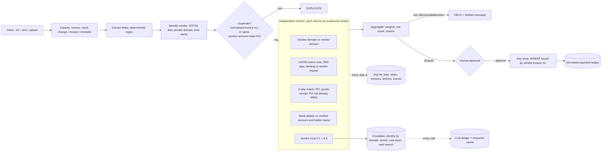

# Payables Desk: Vendor Trust + Pay-Once

ContextCon 05, BITS Pilani · Team Humble Fumblers · Tracks **5. Trust and compliance** + **6. Buying and paying**

An invoice arrives. The agent proves the vendor is real and run by its stated director, screens the director against the news and clears namesakes, matches the invoice to its PO and goods receipt, and catches duplicates, bank-detail changes and look-alike senders. It then **pays once, or holds with a cited reason**. A person approves every payment. Every step is logged and can be replayed.

## The job, and who pays for it today

| | |
|---|---|
| **Job** | Accounts payable for an Indian 3PL: take invoices from the inbox, verify the vendor, match to PO and goods receipt, pay each invoice exactly once, stop fraud before money moves. |
| **Who does it today** | The client's AP team plus outsourced accounting firms (paid per invoice or per month), and KYB/verification vendors (paid per business checked). |
| **Input** | Invoice or email text (`.txt` / `.eml`) in the inbox, the client's vendor master, purchase orders and goods receipts (`data/fixtures/`). |
| **Finished result** | Each document ends as `PAID` (simulated ledger entry with idempotency key), `HELD` (cited reason + drafted verification message), `DUPLICATE` (linked to the original) or `REJECTED` (not payable). |
| **Pass mark** | No invoice paid twice; no payment to an unverified account or unverifiable vendor; every fact cites its source and date; "cannot verify" instead of guessing; a kill at any point resumes without repeating an action. |

## Run it from a fresh clone

Python 3.10+ and the standard library only. No packages to install.

```bash
cp .env.example .env            # then set CRUSTDATA_API_KEY=...
python3 -m vendorcheck.cli inbox        # process every document in data/fixtures/inbox
python3 -m vendorcheck.cli status       # one line per document
python3 -m vendorcheck.cli approve "V001:2026-451" --by "AP lead"   # irreversible step: pay
python3 -m vendorcheck.cli post-bank-lines data/fixtures/bank_lines_oct2026.csv            # bank-statement lines
python3 -m vendorcheck.cli serve --port 8080                       # landing page + app at http://127.0.0.1:8080
```

A vendor check on its own (5.1 + 5.2):

```bash
python3 -m vendorcheck.cli vendor --name "TCI Express" --website tciexpress.in --director "Anil Kumar"
```

**Web app.** `serve` starts the public landing page at `/` and the signed-in app at `/app` (dashboard, inbox, approvals, vendors, vendor check, ledger, activity, settings). Sign-in uses Supabase Auth (Google, or an email sign-in link). Set `SUPABASE_URL` and `SUPABASE_ANON_KEY` in `.env` to turn it on. Every API call then needs a valid session token, and the approver recorded on a payment is the signed-in email, mirrored to a Supabase `approvals` table with row-level security. Without those two variables, or with `AUTH_REQUIRED=0`, the app runs in local mode with no sign-in. The CLI never needs sign-in.

HTTP API (for another system to call; send `authorization: Bearer <session token>` when sign-in is on): `POST /cases`, `GET /cases/<id>`, `GET /api/invoices`, `GET /api/invoices/<key>`, `POST /api/upload`, `POST /api/approve`, `POST /api/recheck`, `GET /api/payments`.

## Results on the test set (live data, 22 Nov 2026)

| # | Document | Expected | Result |
|---|---|---|---|
| 1 | Shadowfax invoice, clean | Pay after approval | `AWAITING_APPROVAL` → approved → `PAID` once |
| 2 | Shreeji Cargo Movers (fictitious front company) | Hold | `HELD`: no company record carries the domain; cannot verify |
| 3 | TCI Express invoice; director "Anil Kumar" (very common name) | Pay, namesakes cleared | `AWAITING_APPROVAL`; 6 adverse articles about other people named Anil Kumar cleared with the reason "does not mention TCI Express" |
| 4 | Shadowfax invoice re-sent as `INV-2026-451` (was `INV/2026/0451`) | Duplicate | `DUPLICATE` of `V001:2026-451` |
| 5 | "We have changed our bank" email | Hold, verify out of band | `HELD` + drafted call-back message to the contact on file (never to the sender) |
| 6 | TCI invoice asking for payment to a new account | Hold | `HELD`: account differs from verified account; PO already invoiced |
| 7 | Invoice from `shadowfaxx.in` (look-alike domain) | Hold | `HELD`: look-alike sender, edit distance 1 |
| 8 | Kill after approval, before payment | Pay once | Restart → `resume` pays once; second resume and re-approve do nothing |

**Bank-statement lines** (the format of the problem statement's own example), `python3 -m vendorcheck.cli post-bank-lines data/fixtures/bank_lines_oct2026.csv`:

| Line | Result |
|---|---|
| 3 Oct, `RAZ*SWIGGY BLR`, ₹1,240 | Payee **Swiggy** (only one of 3 same-name Crustdata records owns swiggy.com and is an established company). Then the legal name is read from the company's own site: swiggy.com's footer states "© 2026 Swiggy Limited", so the payee becomes **Swiggy Limited**, cited to that page and passage. If the site states no legal name, or more than one, the trading name is kept and the reason says "legal name not confirmed". Account: staff meals |
| 7 Oct, `AWS EMEA`, ₹18,500 | Payee **Amazon Web Services EMEA SARL** (vendor master alias). Account: cloud hosting |
| 7 Oct, `AWS EMEA`, ₹18,500 | **Held**: same descriptor, amount and date as the line above; possible duplicate charge |
| 9 Oct, `PAYTM*SHARMA TRD`, ₹4,000 | **Cannot verify**: "SHARMA" matches 4 companies equally; no source identifies the payee. Held for a person |
| 12 Oct, `NEFT/SHADOWFAX TECHNOLOGIES`, ₹2,36,000 | Shadowfax Technologies Limited. Account: freight, last mile. A bank transfer to a vendor on file must match a payment this desk made. After invoice 1 is approved and paid, the line is **reconciled** to that payment (ref, invoice, approver). If no approved payment matches, it is **held**: money left the account with no approved invoice behind it |
| 14 Oct, `UPI/DELHIVERY`, ₹5,600 | Delhivery (Crustdata). Account: freight, express parcel |

Each bank line is posted once. A line's key is its date, description, amount and how many identical lines precede it in the statement. Re-running the file, uploading it under another name, or importing an overlapping statement therefore posts nothing new. Each payment can be claimed by only one bank line. Each line has its own cost limit, so one hard merchant cannot use up the budget for the whole statement. Hitting the limit gives `CANNOT_VERIFY`, never a crash or a guess.

**Offline tests** (no API key, no credits; Crustdata is replaced by canned responses): `python3 -m unittest tests.test_bank -v`. The 9 tests cover:
- the example statement, end to end
- the legal-name citation, and its rules on real and tricky footers
- re-running the file, and re-uploading it under another name
- reconciling a transfer to exactly one payment
- a source outage (the line becomes cannot-verify, not an answer)
- the cost limit
- the cost report

## How it works

The flow, as Mermaid:



**Vendor trust (5.1 + 5.2)**, `vendorcheck/pipeline.py`:

1. **Resolve the entity by domain, never by name alone.** By name, Crustdata returned a French "SAFEXPRESS" at confidence 1.0 above the Indian Safexpress, and three different "Shadowfax" companies at 1.0. If a name maps to more than one company, the result is `CANNOT_VERIFY` with the candidates listed.
2. **Company profile** (`/company/enrich`): name, type, year founded, headcount, HQ, founders/CXOs, news. Crustdata's `status` is cited as the dataset's status, not as registry status.
3. **Website** (`/web/enrich/live`): live, names the company, not parked.
4. **Registry IDs.** A CIN or GSTIN is accepted only if the **fetched page itself** (`/web/enrich/live`) states it next to the company's name. A search snippet is never a source, and search redirect links (`google.com/goto`) cannot be fetched, so they are never cited. If no fetchable page settles it, the output says "registry not confirmed" and why. MCA has no public API, and we do not bypass the portals' CAPTCHAs.
5. **Adverse media.** The company and the director named on the request are screened first, then the leaders on record. Only legal and regulatory terms count (raid, FIR, ED/CBI, NCLT, GST evasion, money laundering); consumer complaints do not. A hit is escalated only when the **fetched article** names the person **and** the company. If the article cannot be retrieved, it is a "possible match" and is held for a person, never treated as a finding. Results about other people with the same name are cleared as namesakes. **Data minimisation:** for namesakes we keep only the count and the reason, never their names, links or passages. The report shows `hits_found / hits_cleared / hits_escalated`.
6. **Verdict:** `CLEAR`, `HOLD` (with flags) or `CANNOT_VERIFY` (naming what is missing). The verdict is cached per vendor, so later invoices from the same vendor cost 0 credits.

**Where a person is needed:** every payment, since it cannot be undone (the approver's name is recorded). Every `HELD` item. Sending any drafted message: the system never sends email or contacts anyone.

## Robustness

- **Exactly once.** The payment row's primary key is `vendor_id:normalised_invoice_no`. Approval and payment are separate states. `resume` (run on every start) pays approved-but-unpaid invoices. Re-running, re-approving or re-resuming changes nothing. Test it with `CRASH_AFTER_APPROVE=1 python3 -m vendorcheck.cli approve ...`, then `python3 -m vendorcheck.cli resume`.
- **Master-data manipulation.** A hash of the vendor record (bank, GSTIN, domain) is stored at approval. If it differs at payment time, the payment is held for re-approval.
- **Restart mid-check.** Each pipeline step is checkpointed. Each API response is cached by request hash before the step is marked done, so a restart replays from cache and is not billed twice.
- **Source failures.** Up to 3 retries with backoff, honouring `x-ratelimit-reset` on 429. If a source is still down, the check is marked `unavailable` ("source unavailable, not the same as no record") and the invoice is held. `Replay checks` (UI) or `POST /api/recheck` re-runs it later.
- **Limits.** Cost limit per job (`MAX_CREDITS_PER_JOB`, default 12 credits) and time limit (`MAX_SECONDS_PER_JOB`, default 180 s). Hitting either gives `CANNOT_VERIFY`, never a guess.
- **Deterministic.** Extraction and decisions are rules, with no LLM in the decision path, so the same input always gives the same verdict.

## Cost per job and price

Measured from the cost ledger (every Crustdata call records its `X-Credits-Used`). ₹25 per credit: the event promo gave $4,500 of usage for 15,000 credits, which is $0.30 per credit.

| Job | Crustdata calls | Measured cost | **Our proposed price** | Gross margin |
|---|---|---|---|---|
| New vendor verified (identify, enrich, website, registry, 3 adverse searches, page fetches) | 7–9 | 7.2–9.2 credits = **₹180–230** | **₹1,500** | ~85% |
| Invoice processed from an already-verified vendor | 0 | **₹0** (local checks; vendor verdict cached) | **₹60** | ~100% before hosting |
| Bank-statement line posted | 0–1 | **₹0–5** | **₹5** | 0–100% |
| Duplicate or bank-change email | 0 | ₹0 | included | — |

The **buyer** is the AP or finance head of a mid-size Indian 3PL. Today they pay an outsourced accounting firm per invoice or per month, and a KYB vendor per business checked. A typical month of 40 new vendors and 2,000 invoices would cost them **₹1,80,000** with us (40 × ₹1,500 + 2,000 × ₹60), against our measured data cost of about **₹9,200** (40 × ₹230). The prices are our proposal, not a market quote. The LLM cost is ₹0 because there is no LLM in the decision path.

## Data sources the service calls

| Source | Endpoint | Used for |
|---|---|---|
| Crustdata Company Identify | `POST /company/identify` | Domain → company record, duplicates and look-alikes |
| Crustdata Company Enrich | `POST /company/enrich` | Name, type, year founded, headcount, HQ, founders/CXOs, news |
| Crustdata Web Fetch | `POST /web/enrich/live` | Website liveness and content |
| Crustdata Web Search | `POST /web/search/live` | CIN listings, adverse media for the company and directors |
| Client records | `data/fixtures/*.json` | Vendor master (verified bank, GSTIN, contact), POs, goods receipts |
| Local computation | none | GSTIN check character, PAN entity type, state code |

## Approaches tried

- **Name-first entity resolution failed** on look-alikes (see above), so we resolve by domain and treat a name-only match as ambiguous.
- **Taking CINs from search snippets** gave four CINs for "TCI Express" (group companies). We now accept only a CIN from a result that names the company, and only if it is unique.
- **A broad adverse-media word list** flagged Shadowfax on consumer complaints ("fake delivery"). We switched to legal and regulatory terms only and require person and company in the same article.
- The research behind the design is in `context/research/` on the `0x1622` branch: a track deep-dive and a vendor-fraud landscape covering HighRadius, Trustpair, Eftsure and the Indian KYB stack. The binding checks (GSTIN ↔ vendor master, bank holder ↔ legal name, sender domain ↔ vendor domain) and re-verification on bank change come from there.

## What is left out, and what's next

- No MCA/GST registry API: MCA has no public API, and the portals use CAPTCHAs, which we do not bypass. Registry status is reported as "not confirmed" with the reason.
- No real bank rails or penny drop. Payments go to a simulated ledger.
- No PEP/sanctions lists yet; OpenSanctions is the next source.
- Next: Person Enrich to test "director works elsewhere", domain age via RDAP, and a Tally / Zoho Books connector in place of the simulated ledger.

## Credits

No third-party code. Python standard library only. Data from the Crustdata API.
