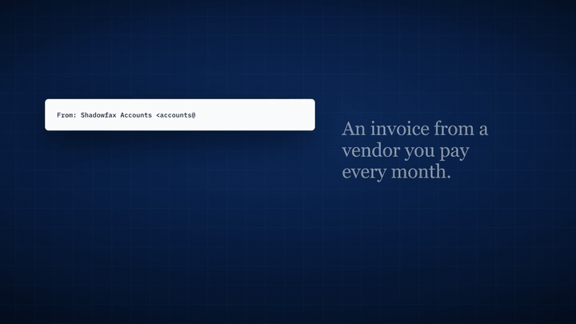
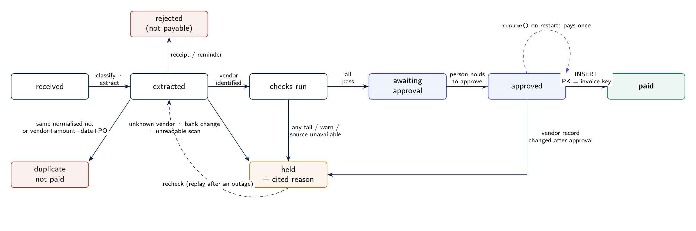

# Payables Desk: Vendor Trust + Pay-Once

ContextCon 05, BITS Pilani · Team Humble Fumblers · Tracks **5. Trust and compliance** + **6. Buying and paying**

> **An accounts-payable agent that verifies every vendor against live records, pays every invoice exactly once, and holds anything it cannot prove with a cited reason.**

`Python 3.10+, standard library only` · `119 offline tests, no keys, no credits` · `every fact cited to a source and a date` · `kill -9 safe at any instruction`

An Indian mid-size 3PL pays hundreds of carriers, fleet owners and warehouses every month. The money leaks
in three ways: an invoice paid twice because it was re-sent as `INV-2026-451` instead of `INV/2026/0451`;
a "we have changed our bank account" email that diverts a payment; a front company with a real-looking
GSTIN and no business behind it. Payables Desk reads each invoice, email, bill photo and bank line, checks it
against the vendor master, the PO and goods receipt, and live company, web and news data from Crustdata.
Then it does one of two things: **it pays exactly once after a person approves**, or **it holds the
invoice and says why, citing the page and the date the evidence came from.**

## ▶ Demo video (2 minutes)

[](https://drive.google.com/file/d/1adEHiQK3HO-6YJY3ulqU43AA9mM9N90C/view?usp=sharing)

**[▶ Watch the demo on Google Drive](https://drive.google.com/file/d/1adEHiQK3HO-6YJY3ulqU43AA9mM9N90C/view?usp=sharing)**. The preview above is the full demo sped up 10×, silent. Click it for the real video with sound.

Design, invariants, schema and failure model: **[docs/ARCHITECTURE.md](docs/ARCHITECTURE.md)**.


---

## The service, and who pays for it today

| | |
|---|---|
| **The job** | Accounts payable for an Indian 3PL: take invoices from the inbox, verify the vendor, match to PO and goods receipt, pay each invoice exactly once, and stop fraud before money moves |
| **Who does it today** | The client's AP team plus an outsourced accounting firm, paid per invoice or per month, and a KYB vendor, paid per business checked. An auditor replays the books later |
| **Who pays** | The AP or finance head of a mid-size 3PL. Today that budget is split across three vendors; we price per job done (see [Cost and price](#cost-and-price)) |
| **Input** | Invoices and emails (`.txt`/`.eml`), photos of paper bills, bank-statement lines, the vendor master, POs and goods receipts |
| **Output** | Each document ends `PAID` (ledger entry with an idempotency key), `HELD` (cited reason, drafted call-back), `DUPLICATE` (linked to the original) or `REJECTED` (not payable) |
| **Pass mark** | No invoice paid twice. No payment to an unverified account or vendor. Every fact cites a source and a date. "Cannot verify" instead of a guess. A kill at any point resumes without repeating an action |

## What it does now

- **Verifies the vendor before the first rupee.** Entity resolution by domain, then company profile,
  founders and CXOs, website, registry identifiers and adverse media, from live Crustdata calls. Every
  fact carries the endpoint or URL, the field and the retrieval date.
- **Checks every invoice:** duplicate (number normalised), sender domain and look-alikes, GSTIN binding
  and check character, three-way match with PO and goods receipt, bank account against the verified one,
  vendor trust, and whether the vendor's own website describes the business being billed.
- **Looks up businesses that are not on file.** A bill from an unknown sender runs the same vendor check
  on what the bill says about itself: name, company email domain or printed website, and GSTIN. The
  bill stays held, because an unknown vendor is never paid.
- **Reads paper bills on the laptop.** A photo is read locally (Apple Vision on macOS, Tesseract
  elsewhere), parsed as an Indian GST invoice (parties, items, CGST/SGST/IGST, IRN, e-way bill, bank)
  and tested against itself: GSTIN check character, taxable value plus tax equals total, total in words
  equals total in figures. The photo and the bank details on it never leave the machine.
- **Catches social engineering.** Jev, a typed decision model, reads each document for a changed
  account, pressure or secrecy, and text addressed to an automated reviewer (prompt injection), and
  quotes the sentence it found. It can add a hold. It can never clear one.
- **Pays exactly once.** The payment key is `vendor_id:normalised_invoice_no`, the primary key of the
  payments table. The insert and the state change share one transaction. A crash between approval and
  payment resumes and pays once; a second approval or a second pay is a no-op.
- **Reconciles the bank statement.** Each line gets a payee with a cited legal name and a ledger
  account. Duplicates are held, transfers are matched to exactly one approved payment, and a payee
  nobody can pin down is `CANNOT_VERIFY`, never a guess.
- **Runs procurement end to end** on Zoho Procurement's flow: an invite-only vendor portal, onboarding
  checks, uploaded invoices turned into bills under a deterministic invoice UUID, and Payments Made
  with idempotency at three layers.

### Where it still needs a person

A person approves every payment, judges every `HELD` item, and sends any drafted message; the system
never sends email. The call-back for a bank change goes to the phone number on file, never the sender.
A company named in legal news is held for a person to judge its role, never auto-rejected. Registry
status (MCA, GST portal) is reported as "not confirmed" because those portals have no public API and use
CAPTCHAs, which we do not bypass.

## Results on the test set (live Crustdata, 22 Nov 2026)

| # | Document | Result |
|---|---|---|
| 1 | Shadowfax invoice, clean | `AWAITING_APPROVAL` → approved → `PAID` once |
| 2 | Shreeji Cargo Movers (fictitious front company) | `HELD`: no company record carries the domain |
| 3 | TCI Express, director "Anil Kumar" | Namesakes cleared. A news report of a raid at a TCI warehouse holds the invoice with the passage cited, for a person to judge (see [the hardest case](#the-hardest-case)) |
| 4 | Shadowfax re-sent as `INV-2026-451` (was `INV/2026/0451`) | `DUPLICATE` of `V001:2026-451` |
| 5 | "We have changed our bank" email | `HELD` + call-back draft to the contact on file, never the sender |
| 6 | TCI invoice to a new account | `HELD`: account ≠ verified; PO already invoiced |
| 7 | Invoice from `shadowfaxx.in` | `HELD`: look-alike domain, edit distance 1 |
| 8 | Kill after approval, before payment | `resume` pays once; repeats are no-ops |
| 9 | Bill from Delhivery, a business not on file | `HELD` with a background check: public company, founded 2011, ~35,300 employees, website live and naming the company, 7 namesake adverse results cleared. 8.2 credits |

| Bank line | Result |
|---|---|
| `RAZ*SWIGGY BLR` ₹1,240 | **Swiggy Limited**: one of 3 same-name records owns swiggy.com; legal name cited from the site footer. Account: staff meals |
| `AWS EMEA` ₹18,500 | Amazon Web Services EMEA SARL (vendor-master alias). Account: cloud hosting |
| `AWS EMEA` ₹18,500 (again) | `HELD`: same date, descriptor and amount |
| `PAYTM*SHARMA TRD` ₹4,000 | `CANNOT_VERIFY`: 4 companies match equally |
| `NEFT/SHADOWFAX TECHNOLOGIES` ₹2,36,000 | Reconciled to the payment for invoice 1. With no approved payment it would be `HELD` |
| `UPI/DELHIVERY` ₹5,600 | Delhivery. Account: freight, express parcel |

**Bill photos**, including hand-held shots that are tilted 7°, keystoned and underexposed, are read to the
right vendor and invoice number, then go through the same checks as an emailed invoice.

## The hardest case

**A real company, a real raid, and the wrong suspect.** TCI Express is a genuine listed logistics company.
Its invoice names a director, "Anil Kumar", one of the most common names in India. Adverse-media search
returns arrests and FIRs for people called Anil Kumar, and a news report of a raid at a TCI warehouse.

- **Name-only matching** would flag the director for strangers' crimes. **Keyword matching** would
  reject the carrier for a raid on goods it was only transporting.
- The desk counts an adverse result only when **the person and the company appear in the same article**
  and the article uses legal or regulatory terms. The Anil Kumar results are cleared as namesakes and
  stored as a count and a reason only, never as names or links.
- The raid article names the company, so the invoice is **held with the passage quoted** from the fetched
  page, not a search snippet, for a person to decide whether TCI was the suspect or the carrier. A
  company named in legal news is a review item, never an accusation.

## How to run it from a fresh clone

Python 3.10+, standard library only. No `pip install`.

```bash
git clone https://github.com/thechristoalex/contextcon && cd contextcon
cp .env.example .env                           # CRUSTDATA_API_KEY=..., optional TYPESAFE_API_KEY=..., GSTIN_API_KEY=...
python3 -m unittest discover tests             # 119 tests, offline, no keys, no credits
python3 -m vendorcheck.cli serve --port 8080   # landing at /, app at /app, vendor portal at /portal
```

```bash
python3 -m vendorcheck.cli inbox                                   # process data/fixtures/inbox
python3 -m vendorcheck.cli status
python3 -m vendorcheck.cli approve "V001:2026-451" --by "AP lead"
python3 -m vendorcheck.cli scan path/to/bill.jpg                   # photo → local OCR → checks
python3 -m vendorcheck.cli post-bank-lines data/fixtures/bank_lines_oct2026.csv
python3 -m vendorcheck.cli vendor --name "TCI Express" --website tciexpress.in --director "Anil Kumar"
```

**GST registry (optional).** The GST portal has no public API (its search is behind a captcha), so a GSTIN's
registration is looked up through [gstin.cloud](https://gstin.cloud/dev-api/), which serves GSTN data: sign in
with Google, generate a key (10 free credits, then about ₹0.10–0.20 a lookup) and set `GSTIN_API_KEY` in `.env`.
An invoice then fails if its GSTIN is not registered, is cancelled or suspended, or is registered to another legal
name, and the vendor check cites the registration. Answers are cached 7 days. Without a key, or when the lookup
fails, the offline checks (check character, PAN type, vendor master) stand and the reason is shown.

**Demo walkthrough:** [docs/DEMO_SCRIPT.md](docs/DEMO_SCRIPT.md), the use case from the video step by step; `scripts/demo_reset.sh` restores a clean state.

**Crash test:** `CRASH_AFTER_APPROVE=1 python3 -m vendorcheck.cli approve <key> --by X`, then
`python3 -m vendorcheck.cli resume`. The invoice is paid once; a second `resume` or `approve` changes nothing.

## How it's built

One Python process over one SQLite file. Every external effect is idempotent by key or cached by request
hash, so a `kill -9` at any instruction loses no work and never repeats a paid call or a payment.

| Layer | What it is | Where |
|---|---|---|
| **Agents** | The invoice agent (classify → identify vendor → checks → decide → approve → pay), the vendor-check agent (resolve → profile → website → registry → GSTIN → adverse media → verdict), the bank-line agent, and the procurement services | `ap.py`, `pipeline.py`, `bank.py`, `procure/` |
| **Models** | **Rules decide.** Jev (TypeSafe, pinned `jev-1.14.0`) answers typed questions about text already held: yes/no, choice, score. It can add a hold, never clear one, and is never cited as a source. If it is off or down, every check falls back to its rule | `jev.py` |
| **Tools** | Crustdata APIs; local OCR (Apple Vision via `vision_ocr.swift`, Tesseract fallback); a simulated payout API that dedupes on the idempotency key, as real ones do | `crust.py`, `scan.py`, `procure/payables.py` |
| **Data** | Vendor master, POs, goods receipts, chart of accounts (`data/fixtures/`); live Crustdata records and fetched pages | `data/fixtures/`, `http_cache` |
| **Where Crustdata is called** | Only through `crust.call`: cost-limited (12 credits, 180 s per job), retried with backoff honouring `x-ratelimit-reset`, cached by request hash before the step is checkpointed, and logged to the cost ledger | `crust.py` |
| **Where state lives** | SQLite in WAL mode: `jobs` and `steps` (checkpoints), `http_cache`, `ledger` (cost), `invoices`, `payments` (primary key = payment key), `files_seen`, `events`, `bank_lines`, procurement tables | `store.py`, `data/vendorcheck.db` |



Diagrams (public links for the form): [system architecture](https://github.com/thechristoalex/contextcon/blob/main/docs/system-latex.png) ([PDF](https://github.com/thechristoalex/contextcon/blob/main/docs/latex/system.pdf)) ·
[invoice state machine](https://github.com/thechristoalex/contextcon/blob/main/docs/statemachine-latex.png) ·
[agent flow](https://github.com/thechristoalex/contextcon/blob/main/docs/agent-flow.png) ·
[vendor check](https://github.com/thechristoalex/contextcon/blob/main/docs/vendor-check.png) ·
[value chain](https://github.com/thechristoalex/contextcon/blob/main/docs/value-chain.png).
Rebuild the LaTeX figures with `cd docs/latex && tectonic system.tex && tectonic statemachine.tex`.

## Sources and checks

| Source | Endpoint | Used for |
|---|---|---|
| Crustdata | `POST /company/identify` | Domain or name → company record |
| Crustdata | `POST /company/enrich` | Type, founded, headcount, HQ, founders/CXOs, news |
| Crustdata | `POST /web/enrich/live` | Website liveness and content; fetching every page we cite |
| Crustdata | `POST /web/search/live` | CIN, GSTIN, adverse media |
| TypeSafe Jev | `POST /v1/systemone` | Typed decisions about text already held. Not a source |
| gstin.cloud (GSTN data) | `GET /api/v1/verify/{GSTIN}` | GST registration: registered, Active/Cancelled, legal name, since when. Off without `GSTIN_API_KEY` |
| Local | — | GSTIN check character, PAN holder type, state code, OCR |
| Client | `data/fixtures/*.json` | Vendor master, POs, goods receipts, chart of accounts |

**Rules every source obeys**

- **Entity by domain, not name.** Searched by name, Crustdata returned a French "SAFEXPRESS" at
  confidence 1.0 above the Indian one, and three "Shadowfax" records at 1.0. A name maps to a company
  only if exactly one match has confidence ≥ 0.95 and an exact name; otherwise `CANNOT_VERIFY`, with the
  candidates listed.
- **Only fetched pages are sources.** A CIN, GSTIN or adverse-media hit counts only when the page, fetched
  live, states it next to the company's name. Search snippets and redirect links are never cited.
- **Data minimisation.** Namesakes are stored as a count and a reason. Tax IDs, bank numbers, phones and
  emails are redacted before any model call. Bill photos are read on the machine.

**Approval points.** Every payment needs a person: hold-to-approve in the app records the approver's
name; `approve --by` on the command line. Adding a vendor to the master, approving a procurement vendor,
and any bank-detail change go back to a person. A bank change from the vendor portal stops payments until
it is re-approved.

**Cost ledger.** Every Crustdata call records its `X-Credits-Used`, cache hit or miss, and the job it
belongs to (`ledger` table). Each vendor check reports its own cost in credits and rupees, and the
Insights screen shows data cost against price.

## Cost and price

₹25 per credit ($4,500 promo / 15,000 credits).

| Job | Calls | Measured | Proposed price |
|---|---|---|---|
| New vendor verified | 7–9 | 7.2–9.2 cr = ₹180–230 | ₹1,500 |
| Invoice, vendor already verified | 0 | ₹0 (verdict cached) | ₹60 |
| Bank line, known payee | 0 | ₹0 | ₹20 |
| Bank line, new merchant | 2 | 1.2 cr = ₹30 | ₹20 |
| Statement of 6 lines, 3 new merchants (live) | 5 | 2.6 cr = ₹65 | ₹120 |

A typical month for a mid-size 3PL (40 new vendors, 2,000 invoices, 1,000 bank lines) bills **₹2,00,000**
against about **₹12,200** of measured data cost, a gross margin of about 94%. The prices are our proposal,
not a market quote. Jev adds about 1,500–2,000 input tokens per document, roughly ₹0.007.

**At 100× volume**, cost grows with new vendors, not invoices: a verified vendor's verdict is cached and
re-checked only when its record changes, and a repeat merchant on a bank line costs nothing. A second
client gets its own database (`VENDORCHECK_DB`) and data folder (`VENDORCHECK_DATA`); nothing is shared but the code.

## How we tested it

- **119 offline tests** (`python3 -m unittest discover tests`). They need no key and no credits:
  `tests/offline.py` turns Jev off and drops its key before import, and Crustdata is replaced by canned
  responses. Each test runs on a fresh temporary database.

  | File | Tests | Covers |
  |---|---:|---|
  | `test_bill.py` | 29 | Parser on stored OCR output of real TallyPrime/Vyapar photos and public samples (`data/fixtures/ocr/`) |
  | `test_scan.py` | 23 | Rows, tilt, rupee/GSTIN repair, provenance, legibility; 2 run the real reader on `data/fixtures/bills/` |
  | `test_background.py` | 22 | Unknown-sender checks, PAN types, free mail, GSTIN-only, outage + replay, www fallback |
  | `test_payables.py` | 11 | Every inbox outcome, idempotent re-run, crash-resume, vendor-hash guard, outage hold |
  | `test_bank.py` | 9 | Statement end to end, legal-name rules, re-import, one-payment reconciliation, budget |
  | `test_procure.py` | 10 | Onboarding flow and front-company block, shared bank account, invoice-number formats, file re-upload, key replay/misuse, crash after transfer, 6 concurrent payments → 1 recorded, bank change before transfer |
  | `test_website.py` | 5 | Fetch fallback order and human_mode |
  | `test_gstreg.py` | 10 | GST registry: active passes, cancelled / not registered / other name fail, cache, sandbox never decides, outage, no key = no call |

- **Live runs** with Crustdata on 22 Nov 2026 produced the results tables above, including the Delhivery
  background check.
- **Crash and restart:** a kill between approval and payment, then `resume`, pays once.
- **The app, clicked end to end:** A headless-Chrome audit clicked every button, link, tab and row on all 13
  screens and two case pages (202 elements), pressed every keyboard shortcut (`g` + letter to all 13 screens,
  the ⌘K palette, `j`/`k`/Enter, `/`, Escape, Space to hold-and-approve), and walked the vendor-portal sign-up
  from invite to submission. It found three bugs; all three are fixed:
  - **Replay could file the original invoice as a duplicate of its own copy.** Rows marked duplicate are no
    longer matched as the original (`test_replaying_the_original_never_makes_it_a_duplicate_of_its_copy`).
  - **Parallel reads on one shared SQLite connection could report an existing invoice as missing.** Each
    thread now has its own WAL connection, and a 20-way burst returns 100/100 correct (70/70 with writes mixed in).
  - **Vendor-master rows on the Procurement screen did nothing when clicked.** They now open the vendor drawer.

## Approaches we tried

- **Name-first entity resolution.** It failed on look-alikes and foreign namesakes, so resolution is by
  domain first.
- **CINs taken from search snippets.** "TCI Express" gave four group-company CINs. Now the fetched page
  must state the CIN, and there must be exactly one.
- **A broad adverse-media word list.** It flagged Shadowfax for consumer complaints. Now only legal and
  regulatory terms count, and the person and the company must appear together.
- **An LLM in the decision path.** We kept decisions as rules so that every verdict replays identically;
  the model answers typed questions and can only make a decision more careful.
- **Cloud OCR for bill photos.** Free tiers let the provider read or train on uploads, and the photo carries
  bank details. Bills are read on the machine instead, for ₹0.

## What we left out

- MCA/GST registry lookups: no public API, and the portals use CAPTCHAs, which we do not bypass.
- Real bank rails or penny drop. Payments go to a simulated ledger and a simulated payout API, both keyed
  by idempotency key.
- PEP and sanctions screening, domain age, and a Tally or Zoho Books connector.

## What it could do in the future

| Next | Why not today |
|---|---|
| Pay through Razorpay or Stripe test mode, passing our payment key as the provider's idempotency key | The simulated payout API already proves exactly-once; a provider adds a second guard, not a new decision |
| OpenSanctions screening for directors | A new source needs its own namesake rules, or it trades false negatives for false positives |
| Domain age via RDAP; Person Enrich to test whether a director works elsewhere | Each is a new signal that needs tuning on real fronts before it can change a verdict |
| A Tally or Zoho Books connector in place of the local ledger | Needs a client's sandbox |

## The future of this service

Today an Indian mid-size company pays three parties to move one rupee safely: an AP team or outsourced
accounting firm to process invoices, a KYB vendor to check new suppliers, and an auditor to replay the
books. Once agents can do the whole job, these merge into one service:

- every vendor is checked against live records before its first invoice, and again whenever its record changes;
- every rupee leaves exactly once, with a cited reason;
- every bank line is tied back to an approved invoice.

The person in the loop stops doing the routine work. They approve what cannot be undone and judge the
cases no source can settle. The firm is paid per job done rather than per hour, and the audit trail is a
by-product, not a separate engagement.

## Credits

No third-party code. Python standard library only. Data from the Crustdata API.

**Fonts.** Inter and IBM Plex Mono from Google Fonts. The landing headline uses **PP Mondwest** by Pangram
Pangram Foundry (https://pangrampangram.com) when the font is installed or placed at
`vendorcheck/static/PPMondwest-Regular.otf`. The font file is not in this repository because its trial licence does not allow redistribution; without it the page falls back to
Cormorant Garamond / Georgia. Get the font and a fitting licence from the foundry.
