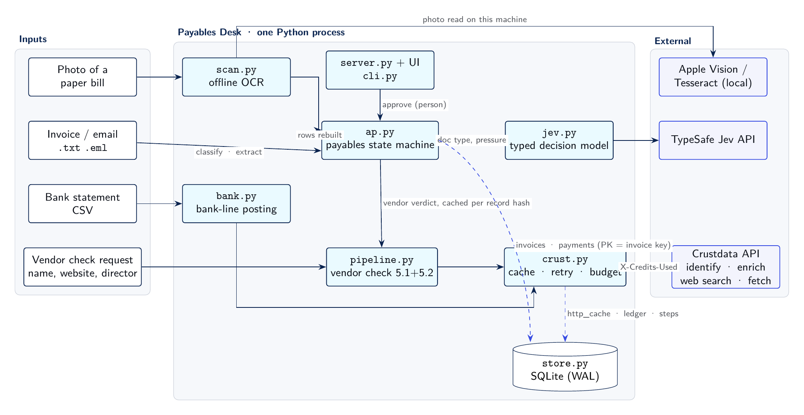

# Payables Desk

### Every vendor proven first. Every invoice paid once.

An accounts-payable agent for Indian logistics companies. It verifies every vendor against live records, pays each invoice **exactly once** after a person approves, and holds anything it cannot prove, **citing the page and the date** the evidence came from.

ContextCon 05 · BITS Pilani · Team Humble Fumblers · Tracks **5. Trust and compliance** + **6. Buying and paying**

[](https://drive.google.com/file/d/1adEHiQK3HO-6YJY3ulqU43AA9mM9N90C/view?usp=sharing)

**[▶ Watch the 2-minute demo](https://drive.google.com/file/d/1adEHiQK3HO-6YJY3ulqU43AA9mM9N90C/view?usp=sharing)** (the preview above is the same video, 10× speed, silent)

`Python stdlib only` · `119 offline tests` · `every fact cited and dated` · `kill -9 safe`

---

## One inbox, five outcomes

The test set, run against live Crustdata on 22 Nov 2026:

```
 INV/2026/0451          Shadowfax       ₹2,36,000   ●  paid once, after a person approved
 INV-2026-451           Shadowfax       ₹2,36,000   ⊘  duplicate: the same invoice, re-sent
 INV/2026/0498          shadowfaxx.in   ₹88,500     ◔  held: look-alike sender, one letter off
 "we changed our bank"  TCI Express     —           ◔  held: call-back drafted to the number on file
 SCM-778                Shreeji Cargo   ₹4,12,500   ◔  held: no company record carries its domain
```

**₹8,95,400 held or stopped before payment. Zero invoices paid twice**, including when the process is killed between approval and payment.

---

## The service

| | |
|---|---|
| **The job** | Take invoices from the inbox, verify the vendor, match the PO and goods receipt, pay each invoice once, stop fraud before money moves |
| **Who does it today** | An AP team plus an outsourced accounting firm (per invoice or per month), a KYB vendor (per business checked), and an auditor who replays the books later |
| **Who pays** | The AP or finance head of a mid-size Indian 3PL. We price per job done: [cost and price](#cost-and-price) |
| **In → out** | Invoices, emails, bill photos and bank lines in. Each one ends `PAID`, `HELD` (with a cited reason), `DUPLICATE` or `REJECTED` |

## What it does now

- **Proves the vendor before the first rupee.** Resolves the company by domain, then checks its profile, directors, website, registry IDs and adverse media through live Crustdata calls.
- **Checks every invoice** for duplicates (numbers normalised), look-alike senders, GSTIN binding and live GST registration, a three-way match with PO and goods receipt, the bank account against the verified one, and whether the vendor's own website describes what is being billed.
- **Reads paper bills on the laptop** (Apple Vision, Tesseract elsewhere). The photo and the bank details on it never leave the machine.
- **Catches social engineering.** Jev, a typed decision model, flags changed accounts, pressure, secrecy and text aimed at an automated reviewer. It can add a hold, never clear one.
- **Pays exactly once.** The payment key `vendor_id:normalised_invoice_no` is the primary key of the payments table, written in the same transaction as the state change.
- **Reconciles the bank statement.** Each line gets a payee with a cited legal name, a ledger account, and a match to exactly one approved payment.
- **Runs procurement end to end**: invite-only vendor portal, onboarding checks, bills and payments with idempotency at three layers.

**Where it still needs a person:** every payment (hold-to-approve, recorded by name), every `HELD` item, and every message, which the desk only drafts and never sends. A bank-change call-back goes to the number on file, never to the sender. A company named in legal news goes to a person to judge, never auto-rejected. MCA company status is reported as "not confirmed": MCA has no public API and its portal uses CAPTCHAs, which we do not bypass.

## The hardest case

TCI Express is a real listed carrier. Its invoice names a director, "Anil Kumar", one of the most common names in India. A news search returns arrests of other men with that name, and a raid at a TCI warehouse.

Name matching would accuse the director. Keyword matching would reject the carrier for goods it was only transporting. The desk counts a result only when **the person and the company appear in the same fetched article**, in legal or regulatory terms. So the namesakes are cleared (and stored only as a count), and the raid holds the invoice **with the passage quoted** for a person to decide: suspect or carrier?

## Run it from a fresh clone

No `pip install`. Python 3.10+ and the standard library.

```bash
git clone https://github.com/thechristoalex/contextcon && cd contextcon
cp .env.example .env                           # CRUSTDATA_API_KEY=...  (optional TYPESAFE_API_KEY, GSTIN_API_KEY)
python3 -m unittest discover tests             # 119 tests: offline, no keys, no credits
python3 -m vendorcheck.cli serve --port 8080   # landing /, app /app, vendor portal /portal
```

```bash
python3 -m vendorcheck.cli inbox                               # process data/fixtures/inbox
python3 -m vendorcheck.cli approve "V001:2026-451" --by "AP lead"
python3 -m vendorcheck.cli scan path/to/bill.jpg
python3 -m vendorcheck.cli post-bank-lines data/fixtures/bank_lines_oct2026.csv
python3 -m vendorcheck.cli vendor --name "TCI Express" --website tciexpress.in --director "Anil Kumar"
```

**GST registry (optional).** The GST portal has no public API, so a GSTIN's registration is looked up through [gstin.cloud](https://gstin.cloud/dev-api/) (GSTN data). Set `GSTIN_API_KEY` in `.env` (10 free credits, then about ₹0.10–0.20 a lookup). An invoice then fails if its GSTIN is unregistered, cancelled, suspended or registered to another legal name, and the vendor check cites the registration. Cached 7 days. Without a key, the offline checks stand and say so.

**Kill it mid-payment:** `CRASH_AFTER_APPROVE=1 python3 -m vendorcheck.cli approve <key> --by X`, then `python3 -m vendorcheck.cli resume`. It pays once. Run either again and nothing changes.

Walkthrough of the demo: [docs/DEMO_SCRIPT.md](docs/DEMO_SCRIPT.md) · reset to a clean state: `scripts/demo_reset.sh`

## How it's built

One Python process over one SQLite file. Every external effect is idempotent by key or cached by request hash, so a `kill -9` at any instruction loses no work and never repeats a paid call or a payment.



| | |
|---|---|
| **Agents** | Invoice (classify → identify → check → decide → approve → pay), vendor check (resolve → profile → website → registry → adverse media → verdict), bank line, procurement · `ap.py` `pipeline.py` `bank.py` `procure/` |
| **Models** | **Rules decide.** Jev (TypeSafe, pinned `jev-1.14.0`) answers typed questions about text already held. It is never a source, and if it is down each check falls back to its rule · `jev.py` |
| **Tools** | Crustdata APIs, local OCR, a simulated payout API that dedupes on the payment key · `crust.py` `scan.py` `procure/payables.py` |
| **Where Crustdata is called** | Only through `crust.call`: cost-limited per job, retried with backoff, cached before the step is checkpointed, logged to the cost ledger |
| **Where state lives** | SQLite (WAL): job checkpoints, HTTP cache, cost ledger, invoices, payments, events, bank lines · `store.py` |

Design, invariants and failure model: **[docs/ARCHITECTURE.md](docs/ARCHITECTURE.md)** · Diagrams: [system](https://github.com/thechristoalex/contextcon/blob/main/docs/system-latex.png) · [state machine](https://github.com/thechristoalex/contextcon/blob/main/docs/statemachine-latex.png) · [agent flow](https://github.com/thechristoalex/contextcon/blob/main/docs/agent-flow.png) · [vendor check](https://github.com/thechristoalex/contextcon/blob/main/docs/vendor-check.png) · [value chain](https://github.com/thechristoalex/contextcon/blob/main/docs/value-chain.png)

## Sources and checks

| Source | Used for |
|---|---|
| Crustdata `company/identify` · `company/enrich` | Domain → company; type, founding year, headcount, HQ, founders, news |
| Crustdata `web/enrich/live` · `web/search/live` | Website liveness; fetching every page we cite; CIN, GSTIN, adverse media |
| gstin.cloud (GSTN data) `verify/{GSTIN}` | GST registration: active or cancelled, legal name, since when. Off without `GSTIN_API_KEY` |
| TypeSafe Jev `v1/systemone` | Typed decisions about text already held. Not a source |
| Local | GSTIN check character, PAN holder type, state code, OCR |
| Client records | Vendor master, POs, goods receipts, chart of accounts |

- **A company is found by its domain, not its name.** Searched by name, Crustdata ranked a French "SAFEXPRESS" at confidence 1.0 above the Indian one, and returned three "Shadowfax" records at 1.0. Anything ambiguous is `CANNOT_VERIFY`, with the candidates listed.
- **Only fetched pages are sources.** Search snippets and redirect links are never cited.
- **Data minimisation.** Namesakes are kept as a count. Tax IDs, bank numbers, phones and emails are redacted before any model call.
- **Approval points.** Every payment, every new vendor, every bank-detail change.
- **Cost ledger.** Every Crustdata call records its credits, cache hit and job; each vendor check reports its cost in rupees.

## Cost and price

| Job | Measured cost | Our price |
|---|---|---|
| New vendor verified (7–9 calls) | ₹180–230 | ₹1,500 |
| Invoice from a verified vendor | ₹0 (verdict cached) | ₹60 |
| Bank line, known payee / new merchant | ₹0 / ₹30 | ₹20 |

A typical month for a mid-size 3PL (40 new vendors, 2,000 invoices, 1,000 bank lines) bills **₹2,00,000** against about **₹12,200** of data cost, a gross margin of about 94%. Prices are our proposal, not a market quote. At 100× volume, cost grows with new vendors, not with invoices. A second client gets its own database and data folder.

## How we tested it

- **119 offline tests** with canned Crustdata responses and a fresh database each: bill parsing (29), scanning (23), unknown senders (22), payables and crash-resume (11), procurement incl. 6 concurrent payments → 1 recorded (10), GST registry (10), bank lines (9), website fetch (5).
- **Live runs** against Crustdata produced every result above.
- **A headless-Chrome audit** clicked all 202 controls across 13 screens and every keyboard shortcut. It found three bugs; all three are fixed and covered by tests.

## Approaches we tried

| Tried | What happened | So now |
|---|---|---|
| Resolving vendors by name | Look-alikes and foreign namesakes at confidence 1.0 | Domain first; a name alone is ambiguous |
| CINs from search snippets | Four group-company CINs for one name | The fetched page must state exactly one |
| A broad adverse-media word list | Shadowfax flagged for consumer complaints | Legal terms only, person and company together |
| An LLM making decisions | Verdicts would not replay | Rules decide; the model can only make them more careful |
| Cloud OCR for bills | Free tiers may read or train on uploads | Read on the machine, for ₹0 |

## What's next

| Next | Why not today |
|---|---|
| Pay through Razorpay or Stripe test mode with our key as the idempotency key | The simulated payout already proves exactly-once; a provider adds a guard, not a decision |
| OpenSanctions screening for directors | A new source needs its own namesake rules first |
| Domain age (RDAP), Person Enrich for directors | New signals need tuning on real fronts before they change a verdict |
| Tally or Zoho Books instead of the local ledger | Needs a client's sandbox |

## The future of this service

Today a mid-size Indian company pays three parties to move one rupee safely: an accounting firm to process invoices, a KYB vendor to check suppliers, and an auditor to replay the books. Agents merge them into one service. Every vendor is checked before its first invoice and again when its record changes, every rupee leaves exactly once with a cited reason, and every bank line ties back to an approved invoice. The person in the loop approves only what cannot be undone and judges what no source can settle. The audit trail stops being a separate engagement and becomes a by-product.

---

No third-party code; Python standard library only. Data from the [Crustdata](https://crustdata.com) API. Fonts: Inter and IBM Plex Mono (Google Fonts). The landing headline uses **PP Mondwest** by [Pangram Pangram](https://pangrampangram.com) (`vendorcheck/static/PPMondwest-Regular.otf`), a trial font: get a licence from the foundry for any use beyond this demo. Without it the page falls back to Cormorant Garamond / Georgia.
