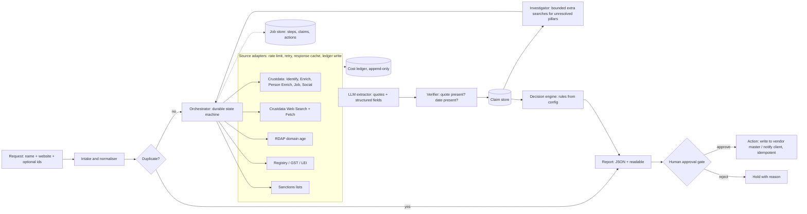

# Trust and Compliance Track: Research and Agent Design

Prepared 22 November 2026 from `ContextCon05_BITS_Problem_Statement.pdf`, `Rules.PDF`, `question.md`, the Crustdata notes in `.claude/skills/crustdata-api/`, and web research (sources at the end).

No Crustdata calls were made for this document. The key is shared with other agents and is limited to 5 requests per minute per endpoint, so every API behaviour cited here comes from the skill notes, which were checked against the live API on 22 Nov 2026.

> **Update.** `vendor_fraud_solution_landscape.md` (same folder) compares HighRadius, Trustpair, Eftsure, Ramp, Persona and the Indian KYB stack. It adds four design changes: verification framed as reconciliation, a binding matrix across identifiers, evidence weighted by cost to fake, and GSTIN used as one link in the chain rather than proof. Section 5 of that doc overrides the matching parts of sections 3–5 here.

> **Rule check.** The rulebook (section 2) allows "ideas, sketches and architecture" before the event and forbids "code before the build starts". This document contains no code. The schemas, rule tables and diagrams are design notes to implement on the day.

---

## 1. What the track asks for

### 1.1 The track, line by line

| Source text | What it means for the build |
|---|---|
| "Compliance teams are paid to decide whom to trust before money moves." | The output is a decision made **before** a payment or contract. It must be defensible, because money depends on it. |
| "Paid today: verification and screening firms, for each business or person they check, for a bank, a payment firm or a large buyer." | Pricing unit = **per business checked** and **per person screened**. The buyer is the party about to move money. |
| **5.1 The Vendor Check:** "A new vendor proven real, active and run by its director." | Three separate claims (real, active, run by its director), each needing its own sourced evidence. |
| **5.2 The Adverse Media Screen:** "Directors screened against the news, namesakes cleared." | Search the news for each director, then separate the real subject from people who share the name. |
| "Fronts caught with evidence, while honest firms and innocent namesakes pass." | The scoring cuts both ways. A missed front fails, and so does flagging an honest firm or a namesake. |
| Sample request: "Here is a new vendor's name and website. Tell me whether it is a real, trading business: who runs it, how long it has existed, and anything that looks off." | Minimum input = name + website. Minimum output = verdict, who runs it, age of business, anomalies. |
| "Company Identify, then Person Enrich, then Web Search and Fetch." | This is the suggested Crustdata path. It is a minimum. Registry, domain and sanctions sources fill the gaps (section 5). |

**Recommendation: build 5.1 and 5.2 as one pipeline.** The adverse media screen needs the director list that the vendor check establishes, and the sample request already covers both ("who runs it … anything that looks off"). One service, two reports: a vendor verdict and a per-director screening result.

### 1.2 Global requirements that matter most for this track

| Requirement (PDF) | Consequence here |
|---|---|
| Every fact links to its record, "the exact passage or field … and the date of that record". "A page about the same topic is not enough." | Every claim carries a quote or field path plus a date. A news article about *a* Rahul Sharma does not support a claim about *this* Rahul Sharma. |
| "If no source settles a question, the output says cannot verify and names what is missing." | `CANNOT_VERIFY` is a first-class verdict with a "missing" list. |
| "A wrong answer counts against a team more than cannot verify." | Set conservative thresholds. When unsure, refer to a person instead of guessing. |
| Hidden test cases: "a duplicate record, a lookalike name, or a question that the sources cannot settle", all dated after 1 Sep 2026. | Section 2 lists the cases to expect. Memory of the model is useless, so live sources are mandatory. |
| Irreversible actions wait for a person. | Clearing a vendor into the client's vendor master, telling the client, and recording a person as adverse all go through an approval gate. |
| Time limit and cost limit per run; cost of each call recorded. | Budget-aware planner plus an append-only cost ledger (section 7.4). |
| Kill on stage: "each action happens once". | Durable step state plus idempotency keys (section 7.2). |
| Hour-3 requirement change; 5-minute live fix. | Rules, thresholds, keyword lists and output fields live in a config file, not in code paths (section 11). |
| Rulebook 3.3: "Agents never contact real people." | The agent never emails a vendor or director. Any "ask the vendor for documents" step goes to a teammate. |

### 1.3 Where the finals points come from

| Area (points) | What earns it in this design |
|---|---|
| Live run (20) | Unseen vendor taken to a sourced verdict. Strong entity resolution and a reliable `CANNOT_VERIFY` path. |
| Robustness (15) | Kill mid-run, restart, no repeated paid calls, no second approval request, same final verdict. |
| Design (15) | Config-driven rules for the live fix; prepared answers for 100x volume and a second client (section 10). |
| Ethics (25) | Data minimisation for directors, namesake protection, "alleged vs convicted" labelling, a human decides before anyone is marked adverse, every verdict explained by rules and sources (section 8). |
| Financial feasibility (25) | Measured credits and rupees per job from the ledger, a named buyer, a per-vendor price (section 9). |

Ethics and finance are half the finals score, and this track is strong on both: a namesake wrongly flagged is a clear ethics story, and vendor verification has a known buyer and unit price.

---

## 2. Hidden test cases to expect

Each case below follows the PDF's stated hard-case patterns. Build your own test set around these shapes.

| # | Case | What the correct result probably looks like | What the agent must do |
|---|---|---|---|
| 1 | Honest, established vendor (a real Indian carrier or warehouse firm) | `CLEARED`, with director named and every pillar sourced | Resolve by domain, confirm registry, activity and director link. |
| 2 | Honest but new vendor (incorporated after Sep 2026) | Real and run by its director, but "active" may be thin. Likely `REFER` or `CANNOT_VERIFY` on activity, **not** `FLAGGED` | Do not call a firm a front just because it is young. Name the missing evidence. |
| 3 | **Lookalike name**: vendor name close to a well-known carrier, different domain | `FLAGGED`: identity mismatch, possible impersonation | Never accept a name match when the domains disagree. |
| 4 | Front with a polished website and no other trace: domain registered weeks ago, site claims "15 years of service" | `FLAGGED`, listing each contradiction with its source | Compare website claims against domain age, registry date, headcount and director records. |
| 5 | Dormant or struck-off company reused as a vendor | `FLAGGED`: not active / not a legal entity | Read registry status. Note that an invoice dated after strike-off comes from an entity that no longer exists. |
| 6 | Named director who works full-time elsewhere and has no tie to the vendor | `FLAGGED` or `REFER` | Person Enrich: current employer ≠ vendor, no registry directorship. |
| 7 | **Duplicate record**: the same vendor submitted twice (e.g. "Pvt. Ltd." vs "Private Limited", `www.` vs bare domain) | `DUPLICATE` of the earlier record. No second onboarding. | Deduplicate on canonical keys (section 5.1). |
| 8 | Director shares a name with someone in a negative news story | Director cleared as a namesake, citing the passage that shows a different person | Cite a hard conflict from the article (age, city, employer). Absence of evidence does not clear anyone. |
| 9 | Director genuinely in adverse news dated after 1 Sep 2026 | Flag with article, date and status (alleged, charged, convicted) | Match on at least two independent identifiers, not on name alone. |
| 10 | Common name, article gives no identifiers | `CANNOT_VERIFY`: possible match, sent to a person | Do not guess either way. |
| 11 | Source failure (website down, Crustdata 5xx, rate limit) | Degraded but correct result, or `CANNOT_VERIFY` naming the failed source | Retry, fall back, and never crash or invent. |

Cases 3, 7, 8 and 10 are the "lookalike", "duplicate" and "cannot settle" cases the PDF names. In the PDF's own example, the service fails if it posts the duplicate or guesses the payee. The equivalents here are clearing the lookalike and flagging the namesake.

---

## 3. The service from request to result

### 3.1 Input (assumed; the real format comes in the kickoff kit)

- Required: vendor name, website.
- Optional: GSTIN, CIN, registered address, names of claimed directors, the client's existing vendor master (for duplicate checks), purpose of the engagement.

Keep one internal canonical schema and write a thin adapter to whatever format the kickoff kit specifies. The adapter is the only part that changes if the format changes.

### 3.2 Verdicts

| Verdict | When | Next step |
|---|---|---|
| `CLEARED` | All three pillars (real, active, run by its director) are supported by sources. No confirmed adverse match. No sanctions hit. | Waits for a person to approve onboarding. |
| `FLAGGED` | At least one hard red flag with evidence (impersonation, struck off, director has no link to the firm, confirmed adverse media, sanctions hit). | A person reviews the evidence. The agent takes no further action. |
| `REFER` | Only soft red flags, or a possible adverse match. | A person decides. |
| `CANNOT_VERIFY` | A required pillar has no settling source. | Output names exactly what is missing. |
| `DUPLICATE` | Same entity as an existing vendor or an earlier request. | Link to the earlier record. |

Report each pillar separately (`real`, `active`, `run_by_director`, `adverse_media`, `sanctions`) with its own status of `supported`, `contradicted` or `cannot_verify`. The overall verdict follows from the pillar statuses by fixed rules (section 7.1).

### 3.3 Example of a finished result (fictional vendor)

> **Vendor:** Northwind Freight Pvt Ltd, `northwind-freight.example`
> **Verdict:** FLAGGED. Held for review. No onboarding action taken.
>
> **Who runs it:** the website names Director A as Managing Director ("Founded and led by Director A", About page, fetched 22 Nov 2026). Cannot verify that Director A runs the firm: their professional profile lists a current full-time role at a different company since 2021 (`experience.employment_details.current[0].name`, Crustdata Person Enrich, record dated 3 Nov 2026), and no registry record lists them as a director of Northwind.
>
> **How long it has existed:** the website claims "serving India since 2009" (home page, fetched 22 Nov 2026). The domain was registered on 14 Sep 2026 (RDAP `events[eventAction=registration]`, retrieved 22 Nov 2026). The company registry shows incorporation on 2 Sep 2026 (registry page, retrieved 22 Nov 2026).
>
> **Anything off:** (1) a 17-year business history claimed on a 2-month-old domain and company; (2) the named director is employed elsewhere; (3) no employees, job posts or news found (Crustdata Company Identify returned no match for the domain; Job Search count 0).
>
> **Adverse media:** none found for the company. Director A: one article names a person with the same name. Cleared as a namesake: the article gives age 61 and city Kolkata, and the director profile shows Pune with education ending in 2015 ("Director A, 61, a Kolkata-based trader", news page, published 18 Oct 2026).
>
> **Cost:** 18.4 Crustdata credits + ₹N model tokens. Run time 2 min 40 s.

---

## 4. Evidence model: the core of the build

Every statement in the output is a `Claim`. The report is rendered from claims and nothing else.

| Claim field | Content |
|---|---|
| `statement` | Human-readable fact ("Domain registered 14 Sep 2026") |
| `pillar` | real / active / run_by_director / adverse_media / sanctions / anomaly |
| `value` | Normalised value (date, name, number, status) |
| `source_type` | `api` / `web_page` / `registry` / `rdap` / `sanctions_list` |
| `source_ref` | URL, or endpoint + `x-request-id` |
| `locator` | JSON field path (APIs) **or** exact quoted passage (web pages) |
| `record_date` | Date the record itself carries (publish date, `updated_at`), or `null` |
| `retrieved_at` | When we fetched it |
| `supports` / `contradicts` | Which pillar it supports or undermines |

**Rules the verifier enforces before a claim is allowed in the report:**

1. **No source, no claim.** Model output is never a source. The LLM only extracts quotes from text we fetched and classifies them.
2. **The quote must be in the page.** For web claims, the quoted passage must appear in the fetched page text after whitespace and case normalisation. If it does not, drop the claim. This enforces "the source must state the fact itself".
3. **Never cite a search snippet or redirect.** Web search results include `https://www.google.com/goto?url=…` links for news. Fetch the real page and cite that page and passage.
4. **Record dates per Crustdata endpoint** (from the skill's live checks):

| Data | Date to cite |
|---|---|
| Company Search | `metadata.updated_at` (must be named in `fields`) |
| Company Enrich | `metadata.updated_at` comes back `null`. Cite retrieval time + `x-request-id`, or run a cheap Company Search on the id to get `metadata.updated_at` (0.03 credits). |
| Person Enrich | `updated_at`, returned only when listed in `fields` |
| Person Search | `metadata.updated_at` |
| Job Search | `metadata.date_added` (posted), `metadata.date_updated` |
| Web Fetch | `timestamp` in **seconds** |
| Web Search | `timestamp` in **milliseconds** |
| Social posts | `date_posted` |

5. **Dates after 1 Sep 2026 matter.** Crustdata's indexed data refreshes every 1–30 days, and the live endpoints are disabled on a Starter key. For events after September, the news path (Web Search with `start_date`) and the website and registry fetches carry most of the weight.

---

## 5. Vendor Check (5.1), pillar by pillar

### 5.1 Identity resolution: is this the company it claims to be?

1. **Normalise.** Name: lowercase, strip legal suffixes (Pvt Ltd, Private Limited, LLP, Ltd, &/and, punctuation). Domain: registrable domain only (drop `www.`, scheme, path).
2. **Company Identify by domain** (`POST /company/identify`, `domains`, 0.2 credits per match). A domain lookup is direct.
3. **Compare names.** Fuzzy-compare the input name with `basic_info.name`. A good domain match with a very different name is a soft flag (rebrand or reseller) and needs an explanation.
4. **If the domain gives no match**, try Identify by name, but **never take `matches[0]`**. In the skill's live test, `names: ["Serve Robotics"]` returned 25 candidates, and the docs show ties at 1.0. If the best name match has a different `primary_domain` from the vendor's website, treat it as a **lookalike signal**, not an identity. This is the impersonation test (case 3).
5. **Duplicate check** against the client's vendor master and earlier requests on canonical keys: `crustdata_company_id`, normalised domain, CIN, GSTIN, normalised name + city. Any exact key match gives `DUPLICATE`.

### 5.2 Pillar: Real

| Signal | Source | Field or passage | Strength |
|---|---|---|---|
| Legal entity exists, status active | Company registry (MCA master data; see 5.6 for access) | CIN, company status, date of incorporation | Strong |
| GST registration active, legal name matches | GST "Search Taxpayer" or a GST verification API | GSTIN status, legal name, registration date | Strong |
| Company record exists in a B2B dataset | Crustdata Identify/Enrich | `crustdata_company_id`, `basic_info.year_founded`, `basic_info.company_type`, `locations.headquarters` | Medium |
| Website resolves and states the legal name, address, CIN or GSTIN | Crustdata Web Fetch (`/web/enrich/live`) on home, About and Contact pages | Quoted passage | Medium. The site is self-declared. |
| Domain age consistent with claimed history | RDAP (IANA bootstrap file `data.iana.org/rdap/dns.json` gives the registry endpoint per TLD) | `events` → registration date | Medium. Strong when it contradicts a claim. |
| LEI, if the firm has one | GLEIF API (free, no key) | Legal name, registration status | Strong where present; most small vendors have none. |

Note: Crustdata `basic_info.status` (`active`/`deleted`) describes the Crustdata record. Do not cite it as legal or registry status.

### 5.3 Pillar: Active (trading)

| Signal | Source | How | Cost |
|---|---|---|---|
| Hiring recently | `POST /job/search` filtered on `company.basic_info.company_id` and `metadata.date_added` ≥ 90 days ago, with `limit: 0` + count aggregation | Count without paying for rows | ~0 |
| Headcount present and changing | Company Enrich `headcount.total`, `headcount.timeseries`, growth keys `mom/qoq/yoy` | Non-zero and recent | in Enrich |
| Recent news | Company Enrich `news` (article_url, publish_date) and Web Search `sources: ["news"]` with `start_date` | Fetch the article before citing | 1 per search page |
| Recent social activity | `POST /social_post/search` with `mentions.company_id` or `actor.crustdata_entity_id`, `limit: 0` | Free count | 0 |
| Registry filings up to date | Registry record (last AGM / balance sheet date) | Dormant firms often stop filing. Active status with no filings for 2+ years is a warning sign. | depends on source |
| GST returns being filed | GST return status via a third-party tool | Official filing data needs the taxpayer's own consent | optional |
| Website current | Copyright year, recent posts, working contact form | Weak signal only | in Fetch |

Rule: `active = supported` needs at least one strong, dated activity signal inside the window set in config (e.g. 180 days). A young firm with nothing yet gives `cannot_verify`, not `contradicted`.

### 5.4 Pillar: Run by its director

1. **Collect candidate leaders** from three independent sources:
   - Registry director list (name, DIN, appointment date): strongest.
   - Crustdata Company Enrich `people` section (`founders`, `cxos`, `decision_makers`).
   - Website "About / Team / Contact" pages (quoted).
   - Fallback: `POST /person/search` with `experience.employment_details.current.company_id = <id>` and title `(.)` "director", "founder", "managing director", "ceo" (0.03 per result).
2. **Person Enrich** (`POST /person/enrich`) on the profile URLs. **Batch all directors into one call** (up to 25 URLs). With a 5 RPM limit, one call is far better than five. Request `fields`: `basic_profile`, `experience`, `education`, `updated_at`. Add `assessment` only if your key permits it.
3. **Link test.** A director is linked when `experience.employment_details.current[]` contains the vendor's `crustdata_company_id` (or domain) with a leadership title, **or** the registry lists them as a director. Two sources agreeing makes the claim strong.
4. **Contradiction test.** The claimed director's current full-time role is at another company, with no current role at the vendor and no registry directorship. That is case 6: `FLAGGED` or `REFER`, depending on config.
5. `assessment.authenticity.verdict` (`clearly_genuine` … `clearly_fabricated`), if available, is a **review flag only**. The skill notes say never to base a decision about a person on it alone.

**Verify at kickoff with one call:** whether Company Enrich `people` entries include profile URLs. If they do not, the person-search fallback is the route to Person Enrich.

### 5.5 "Anything that looks off": red-flag catalogue

| Red flag | Detection | Severity |
|---|---|---|
| Vendor name matches a known company but the domain does not | Identify by domain ≠ identify by name | **Hard** |
| Registry status struck off, dissolved or under liquidation | Registry status field | **Hard** |
| Named director has no link to the firm and works elsewhere | 5.4 contradiction test | **Hard** (or Refer) |
| Director or company on a sanctions, debarment or banned list (true match) | Section 6.5 | **Hard** |
| Confirmed adverse media for a director or the company | Section 6 | **Hard** |
| Claimed history much older than domain age or incorporation date | RDAP + registry vs website quote | Hard if large (config, e.g. > 2 years) |
| GSTIN cancelled, or GST legal name ≠ vendor name | GST record | Hard / Soft |
| Website legal name ≠ registry legal name | Text comparison | Soft |
| No employees anywhere, no jobs, no news, no social activity | 5.3 signals all empty | Soft (Refer) |
| Free-mail contact (gmail etc.) on a "large" company site | Website fetch | Soft |
| Domain registered in the last 90 days | RDAP | Soft |
| Website fetch fails or the site is a parked/template page | Web Fetch `success:false`, `http_status` | Soft |
| Registered address shared by many companies, or a virtual office | Web search on the address | Soft |
| Director holds an unusual number of directorships | Registry director page | Soft |
| Active status but no filings for 2+ years | Registry | Soft |

Hard flag → `FLAGGED`. Soft flags only → `REFER`, or `CLEARED` with notes if they fall below a configured count. Every flag is a cited claim.

### 5.6 The registry problem (and how to work around it)

The research found that **MCA21 has no official public API** for company master data. The portal's "View Company/LLP Master Data" and "Enquire DIN Status" pages work without login but use a CAPTCHA. The bulk dataset on data.gov.in stops at November 2023, so it cannot see any company incorporated after 1 Sep 2026. GST "Search Taxpayer" is also CAPTCHA-protected.

Options, in order of preference for a 7-hour build:

1. **Client records.** The kickoff kit may include CIN or GSTIN for vendors. Use what is given and check it.
2. **Third-party verification API with a free tier.** Search results list Infyner's CIN and DIN lookups (stated as free up to 500 requests/day), QorpIQ (₹4 per DIN record), and Cashfree GSTIN verification (₹100 of trial credits). These are vendor claims. Check terms and sign-up time before the event.
3. **Public company-information pages** found with Web Search and read with Web Fetch. These are secondary sources: cite them as such, with retrieval date, and mark them lower strength than the registry.
4. If none settles it, report **cannot verify registry status** and name the missing record. This is a correct answer.

Do not automate CAPTCHA solving on government portals. It is likely against their terms and is a poor ethics story.

---

## 6. Adverse Media Screen (5.2)

### 6.1 Build a subject profile first

From section 5.4, each director gets a profile: full name and variants (initials, honorifics removed, middle name optional, common transliterations), current employer + title, past employers, city and state, approximate age (education years, registry date of birth if available), DIN. **The profile is what separates the subject from namesakes.** Screening a bare name is how false positives happen.

### 6.2 Query plan (Crustdata `/web/search/live`, `sources: ["news"]`, `location: "IN"`)

- `"<full name>" "<company>"`: articles about this person in this role.
- `"<full name>" (fraud OR arrested OR scam OR FIR OR ED OR CBI OR raid OR "money laundering" OR "GST evasion" OR SEBI)`: negative keywords, kept in config.
- Hindi keyword set for regional coverage (धोखाधड़ी, गिरफ्तार, घोटाला) when budget allows.
- The company itself: `"<company legal name>" + negative keywords`.
- Use `start_date`/`end_date` (Unix **seconds**) for the look-back window in config (e.g. 5 years, with recent items weighted higher).

Each search page costs 1 credit and the endpoint allows 10 per minute. Plan about 2 queries per director and 1–2 for the company.

### 6.3 Fetch, then extract

For each result worth checking (title or snippet mentions the name and a negative keyword), fetch the real page with `/web/enrich/live` (up to 10 URLs per call, 1 credit each; match results by `url`, because order can change and failed fetches return `url: null`). The LLM extracts a structured record **with quotes**:

- subject name as written, age, city, employer, role
- allegation type (fraud, corruption, regulatory action, labour/safety, civil dispute…)
- legal status: allegation / FIR / charge-sheet / conviction / acquittal / settled
- event date and publish date

The quote check from section 4 applies to each field.

### 6.4 Match or namesake: the decision matrix

Compare article identifiers with the subject profile:

| Identifier | Agreement | Conflict |
|---|---|---|
| Employer / company named | Strong match | **Hard conflict** if a different employer at the same date |
| Role (director, MD, founder) | Medium | Weak |
| City / state | Medium | **Hard conflict** if clearly different and the profile shows no tie to that place |
| Age / year of birth | Strong | **Hard conflict** if the gap is more than ~5 years |
| Industry (logistics, transport) | Weak | Weak |
| Co-named people (partners, family) | Medium | none |

Decision rules (thresholds live in config):

- **TRUE_MATCH**: name matches **and** at least 2 independent identifiers agree **and** there is no hard conflict. Leads to `FLAGGED`, and a person approves before the finding is final.
- **NAMESAKE_CLEARED**: at least one hard conflict, **cited from the article**. Example: "the article gives age 61, Kolkata; the director's profile shows Pune and education ending in 2015". Absence of identifiers does **not** clear anyone.
- **POSSIBLE_MATCH**: anything else, including a common name with no identifiers in the article. Leads to `REFER` / `CANNOT_VERIFY` with "missing: an identifier linking the article's subject to the director".

### 6.5 Sanctions, debarment and watchlists

| List | Access | Notes |
|---|---|---|
| OpenSanctions (aggregates UN, OFAC, EU, NSE/SEBI debarred ~15k entries, MHA banned organisations, Indian PEPs) | Hosted `/match/{dataset}` API with an API key, or self-host the open-source `yente` matcher on the bulk data | Free for non-commercial use; commercial use needs a data licence. State this in the README. |
| UN Security Council Consolidated List | Official XML download | Check the current URL on un.org before the event. |
| OFAC SDN | Official CSV/XML from OFAC Sanctions List Service | Free. |

Use the same namesake logic as 6.4: a list hit on name alone is `POSSIBLE_MATCH`. Indian lists carry few identifiers, so many hits will need a person.

### 6.6 Why this design fits the "LLMs in screening" evidence

A Federal Reserve study (Sept 2025) reported LLMs cut sanctions-screening false positives by 92% on average in its tests, and proposed a cascade: exact and fuzzy matching for easy cases, an LLM only for the hard ones. OpenSanctions describes the same shape: a classical name matcher finds candidate pairs, then LLMs judge each pair. Our design follows it: cheap deterministic matching first, LLM judgement only on candidate pairs, and a person for anything left uncertain.

---

## 7. Agent architecture

### 7.1 Orchestrator: fixed pipeline plus a bounded investigator

Use a **deterministic state machine** for the main path (intake → identity → real → active → director → adverse media → sanctions → decide → approve), with a small **LLM investigator** step that may run a few extra searches when a pillar is still `cannot_verify` (for example "find the registry page for this company"). The investigator has a hard budget (e.g. 3 extra calls, N credits) and can only add claims through the verifier.

Why not a free-form agent loop: restarts must resume exactly, cost must be predictable under a cost limit, and the ethics judge needs to see why a decision was made. A fixed pipeline gives all three. The investigator keeps the agent's flexibility where it helps.

The **decision engine is plain rules over pillar statuses**, read from config. Example:

- any hard flag → `FLAGGED`
- else any required pillar `cannot_verify` → `CANNOT_VERIFY` (with missing list)
- else any `POSSIBLE_MATCH` or soft flags above the threshold → `REFER`
- else → `CLEARED`

### 7.2 Restart safety (the kill on stage)

- **Job store** (SQLite is enough): `jobs`, `steps(job_id, step, status, output_ref)`, `claims`, `actions(idempotency_key, status)`, `ledger`.
- **Write ahead.** Save each API response to the response cache *before* marking the step done. On restart, a step whose request hash is in the cache is replayed from the cache, so nothing is billed twice.
- **Idempotency key** for each side effect = hash(job id, action type, target). The approval request and the vendor-master write check the key first, so each happens once.
- **Agent Search** (`/agent/searches`), if used, accepts an `Idempotency-Key` header natively.
- Do **not** ship a pre-filled cache. Rulebook 5.4 forbids returning stored results. The cache exists only within and across restarts of a live run.

### 7.3 Failure handling

| Failure | Behaviour |
|---|---|
| 429 rate limit | Sleep `x-ratelimit-reset` + jitter, retry. Pace from response headers (the Starter key's autocomplete enforced 5/min even though the listing said 300). |
| 402 insufficient credits / 403 endpoint disabled | Stop that source. Do not retry. Mark affected pillars `cannot_verify (source unavailable)`. |
| 5xx | Retry with backoff a few times, then fall back. |
| Web Fetch `success: false` | Retry once with `human_mode`, then try another source. |
| Identify/Enrich no match (`200`, `matches: []`) | A finding, not an error: "not found in Crustdata". |
| Person Enrich `redacted` | The person opted out. Do not retry. Use other sources only. |
| Model error / bad JSON | Re-ask once with the schema. If it fails again, drop the claim rather than invent one. |

### 7.4 Cost and time budget per vendor

Estimate at Crustdata list prices (confirm real prices with the free `GET /account/endpoints`):

| Step | Calls | Credits |
|---|---|---|
| Company Identify (domain) | 1 | 0.2 |
| Company Enrich (`basic_info`, `headcount`, `locations`, `people`, `news`, `hiring`) | 1 | 2 |
| Job Search count (`limit: 0`) + Social Post count (`limit: 0`) | 2 | ~0 |
| Person Search fallback (if needed) | 0–1 | ~0.3 |
| Person Enrich, 2–3 directors in one batch | 1 | 2–3 |
| Web Search (company + 2 per director) | 5–8 | 5–8 |
| Web Fetch (website pages, registry page, articles) | 2–3 calls | 6–10 |
| **Total** | | **~16–24 credits** |

Plus model tokens and any paid registry or GST check. Rupees per job = credits × (your plan's ₹ per credit) + tokens + other APIs. Fill in the ₹ per credit from the plan; it is not stated in the materials I have.

**Rate limits are the real clock on a Starter key**: 5 per minute per endpoint for search/enrich/identify, 10 per minute for web search and fetch. Spread calls across endpoints, batch Person Enrich, and expect about 1.5–3 minutes per vendor.

**Budget guard:** each step has an estimated cost. Before calling, the planner checks the remaining budget. Required steps run first. Optional steps (Hindi queries, extra article fetches) are skipped when the budget is low, and the report says what was skipped. Stop early once a hard flag is fully evidenced, if config allows. This is also how you survive a "lower cost limit" change at hour 3.

---

## 8. Ethics design (25 points)

| Concern | Design decision |
|---|---|
| Personal data minimisation | Collect only what the check needs: name, current and past roles, city, approximate age for disambiguation. **Never call `/person/contact/enrich`** (emails, phones); the job does not need them. Do not store Aadhaar, PAN or full date of birth. |
| Purpose limitation and retention | Director data is used only for this vendor decision. Store claims and source references, not full page dumps. Set a retention period in config. |
| Legal footing (DPDP Act 2023, Rules notified Nov 2025) | Section 3(c)(ii) excludes data made public under a legal obligation (e.g. registry director filings), but commentators say its scope is unclear and it may not cover aggregation or profiling. State in the README which data you treat as public and why, rather than assuming everything online qualifies. |
| Presumption of innocence | Every adverse item is labelled with its legal status (alleged, charged, convicted, acquitted). An allegation is never reported as a fact about guilt. |
| Namesake protection | A person is never marked adverse on a name match alone. Clearing a namesake requires a cited conflict. The uncertain middle goes to a person. |
| Human decision on harmful outcomes | The agent recommends. A person approves before a vendor is rejected, a director is recorded as adverse, or the client is told. Rulebook 5.5: a person may only approve or reject, never edit the result. |
| Explainability | Every verdict lists the rules that fired and the claims behind them, each with source, passage and date. |
| No contact with real people | Rulebook 3.3. No outbound email or message to vendors or directors. Teammates play counterparties. |
| Model-generated scores | Treat Crustdata's `assessment.authenticity` and any LLM judgement as review signals, never the sole basis for a decision about a person. |

---

## 9. Financial feasibility (25 points)

- **Buyer.** In the event's story, the 3PL client's procurement and finance controls team, onboarding carriers, warehouse operators, customs brokers and suppliers before paying them. More widely, per the PDF: banks, payment firms and large buyers.
- **What they pay today.** I found no public rupee list price for a full vendor due-diligence report from AuthBridge, IDfy or Signzy; one buyer's guide says all of them quote on request. A third-party guide (undated, unsourced) puts single API checks at about ₹1–5 per GSTIN verification at volume. A full report bundles many checks plus analyst time, which is the real cost.
- **Measured cost.** Show the ledger total per job on stage: credits, rupees, model tokens, seconds. The judges ask for "the measured cost of each job", so measure it rather than estimate it.
- **Price structure to propose:** a per-vendor check price, a per-director screen price, and a monthly re-screening subscription per vendor (built on Crustdata watchers, section 10). Set the per-vendor price from the measured cost and the analyst time it replaces. Do not quote a market price you cannot source.
- **The argument:** a front caught before the first payment saves the whole payment. One prevented fraud pays for many checks.

---

## 10. System-design answers to prepare

**100x volume.** Queue (one job per vendor) with workers. A per-endpoint token-bucket rate limiter shared by all workers. Cache company and person records by id with a TTL, because the same carriers recur across clients. Move from per-call endpoints to `/batch/*` (enterprise: 10,000 ids per company or person enrich job). Use the free `limit: 0` counts wherever a count answers the question. Cost per job falls with caching.

**A second client.** `tenant_id` on every job, claim and ledger row. Per-tenant config: rules, thresholds, keyword lists, budget, output adapter. Shared source cache (public data), separate decisions and approvals.

**Ongoing monitoring.** After a vendor is cleared, create a Crustdata **entity watch** on the company and its directors (delivers changes to a webhook) and re-run the adverse media screen when a director changes or news appears. Watchers bill per delivered change, which suits a subscription price.

---

## 11. Build-day plan (7 hours)

| Time | Work |
|---|---|
| 0:00–0:30 | Read kickoff kit (input/output format, client vendor master, time and cost limits). One free `GET /account/endpoints` to see which endpoints the event key enables. One Company Enrich to check what `people` returns. |
| 0:30–1:30 | Job store, source adapters with rate limit, retry, cache and ledger. Claim schema and verifier. |
| 1:30–3:00 | Identity resolution + Real + Active + Director pillars. First end-to-end run on one real vendor. **Commit.** |
| 3:00 | **Requirement change arrives.** Because rules and output fields are config, most changes are a config edit plus one adapter field. |
| 3:00–4:30 | Adverse media screen + namesake matrix + sanctions check. |
| 4:30–5:30 | Decision engine, report rendering, approval gate (CLI or small page), idempotent actions. |
| 5:30–6:15 | Run your own test set (the 11 shapes in section 2). Fix the worst errors. Kill-and-restart test. |
| 6:15–7:00 | README (job, who pays, input, result, pass mark, every data source, open-source credits), architecture diagram, demo video, final commit. |

**Live-fix readiness (5 minutes on stage).** Likely asks: add an output field, change a threshold (e.g. domain age), add a negative keyword, add a new rule ("vendors younger than 6 months go to REFER"), change the look-back window. If all of these live in one config file and one adapter, each is a one-line change.

**Hour-3 change readiness.** Likely: a new output field (e.g. GSTIN or a risk score), a lower cost limit (the budget guard handles this), or a new rule (config).

---

## 12. Before the event (allowed: ideas, sketches, architecture)

1. Choose language, framework and model, and confirm each teammate's role (sources, pipeline, LLM extraction, report and approval UI, README and diagram).
2. Sign up for any registry or GST verification API and OpenSanctions access now, and check terms and free-tier limits.
3. Write test case *descriptions* for the 11 shapes in section 2 (real companies for the honest cases; fronts and namesake cases played by teammates on the day). Write the actual test data and code on the day.
4. Prepare the ethics and finance talking points (sections 8 and 9) and the system-design answers (section 10).
5. Consider joining a second track: **Infrastructure for agents** ("record where each fact came from and re-check it on demand; approve, hold or block each action") is already covered by the claim store, verifier and approval gate.

---

## 13. Risks and open questions

- **Thin coverage of small Indian vendors.** Many small transporters will not be in Crustdata. Expect `CANNOT_VERIFY` often unless registry and GST sources work. Decide on day one which registry route you use (section 5.6).
- **Company Enrich `people` may lack profile URLs.** Check with one call at kickoff; the person-search fallback covers it.
- **OpenSanctions licence** for a commercial-style demo. Self-hosted `yente` on bulk data, with the licence stated in the README, is the safe route.
- **Transliteration.** Indian names in Hindi-language news and varied English spellings. Keep a name-variant generator in config.
- **Third-party registry mirrors can lag** the MCA record. Cite them as secondary, with dates.
- **The PDF says "a person approves only the actions that cannot be undone".** Decide with the team which actions those are here. Recommended: writing a cleared vendor to the vendor master, any message to the client, and recording a person as adverse.

---

## Sources

Event documents: `ContextCon05_BITS_Problem_Statement.pdf`, `Rules.PDF`, `question.md`. Crustdata behaviour: `.claude/skills/crustdata-api/SKILL.md` and `references/*.md` (live-checked 22 Nov 2026).

Registry and GST access
- [MCA portal](https://www.mca.gov.in/mca/html/mcav2_en/home/home/login/login.html)
- [data.gov.in: RoC-wise Company Master Data](https://www.data.gov.in/resource/registrars-companies-roc-wise-company-master-data)
- [Razorpay Rize: ROC master data, how to access](https://razorpay.com/rize/blogs/?p=1153)
- [Infyner developer APIs](https://www.infyner.com/apis), [QorpIQ MCA API](https://qorpiq.com/mca-api)
- [Tally: GSTIN search and verification](https://tallysolutions.com/gst/gst-pan-search/), [Cashfree GST verification](https://cashfree.com/gst-verification/), [ClearTax taxpayer information API](https://docs.cleartax.in/cleartax-docs/gst-api/gst-api-reference/taxpayer-information)
- [GLEIF API](https://www.gleif.org/en/lei-data/gleif-api), [GLEIF LEI search](https://www.gleif.org/en/lei-data/global-lei-index/how-to-use-lei-search)

Shell-company signals
- [LegalRaasta: shell companies in India (2026)](https://www.legalraasta.com/blog/shell-companies-in-india/)
- [Infyner: fake company warning signs](https://www.infyner.com/research/fake-company-warning-signs)
- [Rajya Sabha answer on struck-off companies](https://rsdebate.nic.in/bitstream/123456789/745689/1/PQ_262_05122023_U195_p171_p171.pdf)
- [DEV: RDAP returns structured JSON for free](https://dev.to/0012303/rdap-is-replacing-whois-and-it-returns-structured-json-for-free-2fga)

Sanctions and watchlists
- [OpenSanctions: India](https://www.opensanctions.org/countries/in), [NSE/SEBI debarred dataset](https://www.opensanctions.org/datasets/in_nse_debarred), [MHA banned dataset](https://www.opensanctions.org/datasets/in_mha_banned)
- [OpenSanctions matching API](https://www.opensanctions.org/docs/api/matching), [yente on GitHub](https://github.com/opensanctions/yente)
- [UN SC Consolidated List](https://www.un.org/sc/suborg/en/sanctions/un-sc-consolidated-list.html), [OFAC SDN list](https://sanctionslist.ofac.treas.gov/Home/static/sdn.html)

Adverse media and LLM screening
- [OpenSanctions: How LLMs are changing screening (May 2026)](https://www.opensanctions.org/articles/2026-05-12-llms-screening/)
- [Federal Reserve: Can LLMs improve sanctions screening?](https://www.federalreserve.gov/econres/feds/can-llms-improve-sanctions-screening-in-the-financial-system-evidence-from-a-fuzzy-matching-assessment.htm)
- [Didit: adverse media screening process and tuning](https://didit.me/blog/adverse-media-screening-process-tuning-guide/)
- [LSEG: why false positives remain a challenge](https://www.lseg.com/en/training/learning-centre/blog/why-false-positives-remain-a-challenge-in-compliance-screening)
- [Thomson Reuters: false positives and false negatives](https://legal.thomsonreuters.com/en/insights/white-papers/white-paper-false-positives-and-false-negatives)

Litigation
- [eCourts High Court services](https://hcservices.ecourts.gov.in/), [DEV: India court API](https://dev.to/rchtjn2/india-court-api-for-legal-tech-1fm5)

Data protection
- [PIB: DPDP Rules 2025](https://static.pib.gov.in/WriteReadData/specificdocs/documents/2025/nov/doc20251117695301.pdf)
- [India Briefing: DPDP Act and publicly available data](https://www.india-briefing.com/news/india-dpdp-act-publicly-available-personal-data-46899.html/)
- [Mondaq: managing personal information of directors](https://www.mondaq.com/india/directors-and-officers/1415316/directors-in-the-digital-age-managing-personal-information-of-directors)

Pricing context
- [productgrowth.in: KYC/identity verification buyer's guide](https://productgrowth.in/tools/kyc-identity-verification/guide/)
- [B2B lending India: KYC and KYB vendors](https://javajack.github.io/b2b-lending-india/04-integrations/kyc-kyb-vendors/)
- [AuthBridge vendor risk management](https://authbridge.com/?p=81303)
