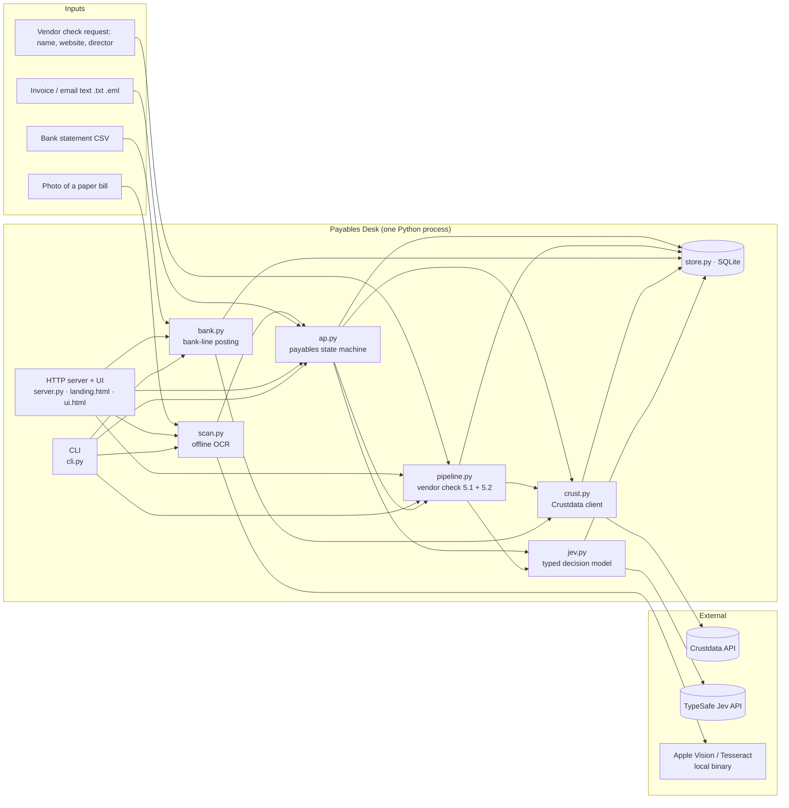
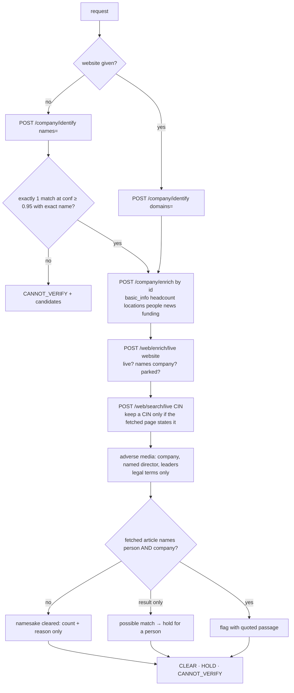
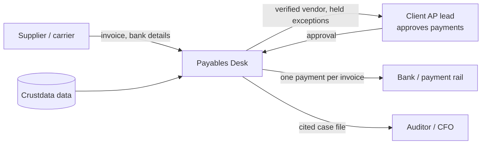

# Payables Desk: technical and business architecture

State as of 22 Nov 2026. Python 3.10+ standard library, SQLite, vanilla HTML/JS. About 2,600 lines in `vendorcheck/`.

---

## Part 1: Technical architecture

### 1.1 System context

### 1.2 Modules

| Module | Lines | Responsibility | Key functions |
|---|---|---|---|
| `server.py` | ~210 | `ThreadingHTTPServer`; serves `/` (landing), `/app` (UI), `/static/*` (no-cache), JSON API; runs `ap.resume()` on start | `H.do_GET`, `H.do_POST`, `serve` |
| `cli.py` | ~64 | `inbox`, `file`, `approve`, `resume`, `vendor`, `post-bank-lines`, `scan`, `status`, `payments`, `ledger`, `serve` | `main` |
| `ap.py` | ~636 | Invoice intake → extraction → checks → decision → approval → exactly-once payment; recheck; resume | `process_file`, `extract`, `classify`, `identify_vendor`, `check_*`, `_finish`, `approve`, `pay`, `resume`, `recheck` |
| `pipeline.py` | ~629 | Vendor check: entity resolution, profile, website, registry IDs, adverse media, verdict; GSTIN maths | `Job.run`, `s_resolve`, `s_profile`, `s_website`, `s_registry`, `s_adverse`, `verify_pages`, `gstin_valid` |
| `bank.py` | ~211 | Bank lines → payee + ledger account, duplicate hold, NEFT reconciled to an approved payment | `post_file`, `decide`, `resolve_payee`, `legal_name_from_site`, `line_key` |
| `scan.py` | ~269 | Photo → text on this machine → rows → `ap.process_file`; field boxes and confidences | photo hashing, OCR runner, row rebuild |
| `jev.py` | ~177 | TypeSafe Jev: typed yes/no, choice and score questions about text already held; never a source | `ask`, `yes`, `pick`, `level`, `quoted`, `redact` |
| `crust.py` | ~112 | Crustdata HTTP client: cache, retries, budget guard, ledger, citation builder | `call`, `source_ref` |
| `store.py` | ~263 | SQLite schema and every state write; WAL; one lock for writes | `upsert_job`, `save_step`, `cache_*`, `ledger_add`, `propose_action`, `execute_action` |
| `config.py` | ~56 | Limits and thresholds from env; editable at runtime via Settings | `CONFIG`, `ADVERSE_TERMS` |

### 1.3 Data stores (SQLite, `data/vendorcheck.db`, WAL mode)

| Table | Primary key | Holds | Why it exists |
|---|---|---|---|
| `jobs` | `job_id` (`trust:V001:<record hash>`) | status, verdict, report JSON | A vendor check finishes once per vendor-record version |
| `steps` | `(job_id, step)` | each pipeline step's output | Restart skips finished steps |
| `http_cache` | `req_hash` = sha256(endpoint + body) | response body, status, credits | A restart replays responses; nothing is paid for twice |
| `ledger` | autoincrement | endpoint, cache hit, credits, latency, HTTP status, job | Cost per job; Crustdata and Jev calls both recorded |
| `invoices` | `invoice_key` = `vendor_id:normalised invoice no.` | extracted fields, state, decision JSON, vendor hash at approval | Invoice state machine |
| `files_seen` | `source_file` + content hash | outcome | Same file with the same content is processed once |
| `payments` | `idempotency_key` = invoice key | amount, account, IFSC, payee, approver, ref | **One invoice, at most one payment** |
| `bank_lines` | `line_key` = sha256(date, descriptor, amount, occurrence) | result, payee, account, reason, evidence, payment key | One statement line posted once |
| `actions`, `vendor_master` | idempotency key / vendor id | approved vendor-master writes | Exactly-once side effects |
| `events` | autoincrement | job, level, message, time | Audit trail shown in the UI |

### 1.4 Invoice state machine (`ap.py`)

```mermaid
stateDiagram-v2
  [*] --> received
  received --> extracted: classify + extract (rules; Jev may escalate doc type)
  extracted --> held: vendor unknown / bank-change request / unreadable scan field
  extracted --> duplicate: same normalised no., or same vendor+amount+date+PO
  extracted --> rejected: receipt / reminder (not payable)
  extracted --> verified: sender domain · GSTIN binding · 3-way match · bank account · vendor check · business match
  verified --> held: any fail / warn / unavailable
  verified --> awaiting_approval: all pass
  awaiting_approval --> approved: person holds to approve (name recorded, vendor hash stored)
  approved --> held: vendor record changed since approval
  approved --> paid: INSERT payments (PK = invoice key) in one transaction
  held --> extracted: recheck (replay after an outage)
```

**Exactly once.** `approve()` and `pay()` are separate transactions. `pay()` runs `INSERT OR IGNORE` into `payments`, then updates the state inside `BEGIN IMMEDIATE`. `resume()` runs on every start and pays anything `approved` but unpaid. Tested by killing the process with `CRASH_AFTER_APPROVE=1`: it pays once on restart, and a second resume or a re-approval does nothing.

**Master-data manipulation.** At approval, `vendor_hash(v)` (bank, GSTIN, domain) is stored. `pay()` recomputes it and holds the payment if it changed.

### 1.5 Checks, weights and the decision

| Check | Inputs | Fail condition | Weight |
|---|---|---|---|
| `vendor_identified` | GSTIN → sender domain → name similarity ≥ 0.5 | no vendor | 80 |
| `duplicate` | normalised invoice no. (`INV/2026/0451` = `INV-2026-451`), or vendor+amount+date+PO | earlier invoice exists | 100 |
| `sender_domain` | email `From` vs vendor domain | edit distance ≤ 3 or brand token in a different domain | 40 |
| `gstin_binding` | check character (mod-36), PAN 4th char = `C` for a company, equals vendor-master GSTIN | any mismatch | 50–60 |
| `three_way_match` | PO amount ±1%, goods-receipt qty, PO not already billed | mismatch | 30–60 |
| `bank_details` | invoice account/IFSC vs account verified at onboarding; holder name vs legal name | differs | 50–60 |
| `vendor_trust` | `pipeline.Job` verdict, cached per vendor-record hash | HOLD / CANNOT_VERIFY / source unavailable | 20–70 |
| `business_match` (Jev) | invoice line items vs the vendor's website text | Jev says unrelated above threshold | soft |

Risk score = sum of the weights of failed checks (half weight for warnings), capped at 100. Any fail, warning or unavailable source gives **HELD**. Otherwise **AWAITING_APPROVAL**.

### 1.6 Vendor check pipeline (`pipeline.py`)

**Citation rules.** Each fact carries `{api|url, field|passage, record_date, retrieved_at, request_hash}`. Search snippets and `google.com/goto` redirects are never cited. A web fact is kept only if a whole-word, visible-text match is found in the page fetched by `/web/enrich/live`, with scripts and styles stripped.

### 1.7 External calls, cost and failure handling

| Call | Endpoint | Cost (measured) | Retry | On final failure |
|---|---|---|---|---|
| Company identify | `POST /company/identify` | 0.2 credits per matched id | 3×, exponential backoff, honours `x-ratelimit-reset` on 429 | check marked `unavailable` → HELD |
| Company enrich | `POST /company/enrich` | 2 credits | same | same |
| Web search | `POST /web/search/live` | 1 credit | same | same |
| Web fetch | `POST /web/enrich/live` | 1 credit per URL | same | fact dropped → "cannot verify" |
| Jev | TypeSafe `/v1/systemone` | ledgered with 0 Crustdata credits | retries, then `Unavailable` | rule result stands; no job waits on Jev |
| OCR | local Apple Vision / Tesseract | ₹0 | n/a | low-confidence field → HELD |

**Limits:** `MAX_CREDITS_PER_JOB` (12) and `MAX_SECONDS_PER_JOB` (180) give `CANNOT_VERIFY` when reached. A 402 (credits exhausted) is not retried.

### 1.8 Restart and kill safety

| Failure point | What survives | Behaviour on restart |
|---|---|---|
| During a vendor check | `steps` + `http_cache` | Finished steps skipped, paid calls replayed from cache |
| During inbox processing | `files_seen`, `invoices` | Unfinished document re-processed; its checks reuse the cache |
| After approval, before payment | `invoices.state = approved` | `resume()` pays once |
| During bank posting | `bank_lines` per `line_key` | Posted lines skipped |
| During a scan | files named by photo hash | Photo not re-read |

### 1.9 HTTP API

`GET /api/invoices` · `GET /api/invoices/{key}` · `POST /api/process` · `POST /api/upload {name,text}` · `POST /api/scan {image}` · `GET /api/scan/{photo}` · `POST /api/approve {key,by}` · `POST /api/recheck {key}` · `GET|POST /api/bank` · `GET /api/payments` · `GET /api/vendors` · `GET /api/events` · `GET|POST /api/settings` · `POST /cases` · `GET /cases/{job_id}`.

### 1.10 Scaling answers

- **100× volume.** Invoice checks cost ₹0 because vendor verdicts are cached per record hash, so Crustdata cost grows with *new vendors*, not invoices. To scale: move SQLite to Postgres with the same primary keys, run checks from a worker queue keyed by invoice key, and batch identify calls (Crustdata allows 15–30 requests per minute per endpoint).
- **A second client.** Add `client_id` to every table and every idempotency key, with row-level security per client. Public facts about a vendor can be shared across clients; bank details never are.
- **Real money.** Replace the simulated ledger with Razorpay/Stripe test mode, passing the invoice key as the provider's idempotency key.

---

## Part 2: Business architecture

### 2.1 Value chain

### 2.2 Who pays today, and what we replace

| Job | Who does it today | How they are paid | What we do instead |
|---|---|---|---|
| Vendor onboarding / KYB | KYB vendors and compliance teams | per business checked | Live check by domain, directors screened, every fact cited |
| Invoice processing and payment | Outsourced accounting firms, in-house AP | per invoice or monthly retainer | Extraction, 3-way match, duplicate and fraud checks, pay once |
| Bank reconciliation | Accountants at month end | hourly or retainer | Bank lines posted to payee and ledger account |

### 2.3 Customer and buyer

- **Buyer:** finance or AP head of a mid-size Indian 3PL with hundreds of carriers, warehouses and suppliers.
- **User:** the AP lead who approves payments.
- **Pain:** duplicate invoices, payment diversion through bank-change emails, look-alike vendors, unverifiable new suppliers, and audit trails that live only in someone's inbox.

### 2.4 Pricing and unit economics (our proposal)

| Unit | Price | Measured cost | Gross margin |
|---|---|---|---|
| New vendor verified | ₹1,500 | 7–9 credits = ₹180–230 | ~85% |
| Invoice processed (known vendor) | ₹60 | ₹0 data (verdict cached); OCR local | ~100% before hosting |
| Bank line posted | ₹5 | ₹0–5 | 0–100% |

₹25 per credit comes from the event promo ($4,500 for 15,000 credits, which is $0.30 per credit). Example month: 40 new vendors and 2,000 invoices bill ₹1,80,000 against about ₹9,200 of data cost.

### 2.5 Controls (ethics and risk)

| Control | Where |
|---|---|
| A person approves every payment (hold-to-approve, name recorded) | `ap.approve`, case view |
| Agents never contact anyone; messages are drafts only | `draft_bank_verification` |
| "Cannot verify" instead of a guess; missing evidence named | `pipeline.missing`, `bank.decide` |
| Data minimisation: namesakes stored as count + reason only | `s_adverse` |
| Every fact sourced and dated; no snippets or redirects | `verify_pages`, `source_ref` |
| Jev can add a hold, never clear one | `jev.py` contract |
| Photos read on the machine; never uploaded | `scan.py` |

### 2.6 Roadmap

1. MCA / GST registry API (paid provider) to confirm CIN, GSTIN status and director DIN.
2. Penny-drop bank-account verification in test mode before the first payment.
3. Crustdata watchers on every vendor: a change in headcount, news or domain triggers a re-check.
4. A network across clients: verified bank details shared with consent (the Eftsure / Trustpair moat).
5. Tally / Zoho Books connector in place of the simulated ledger.
